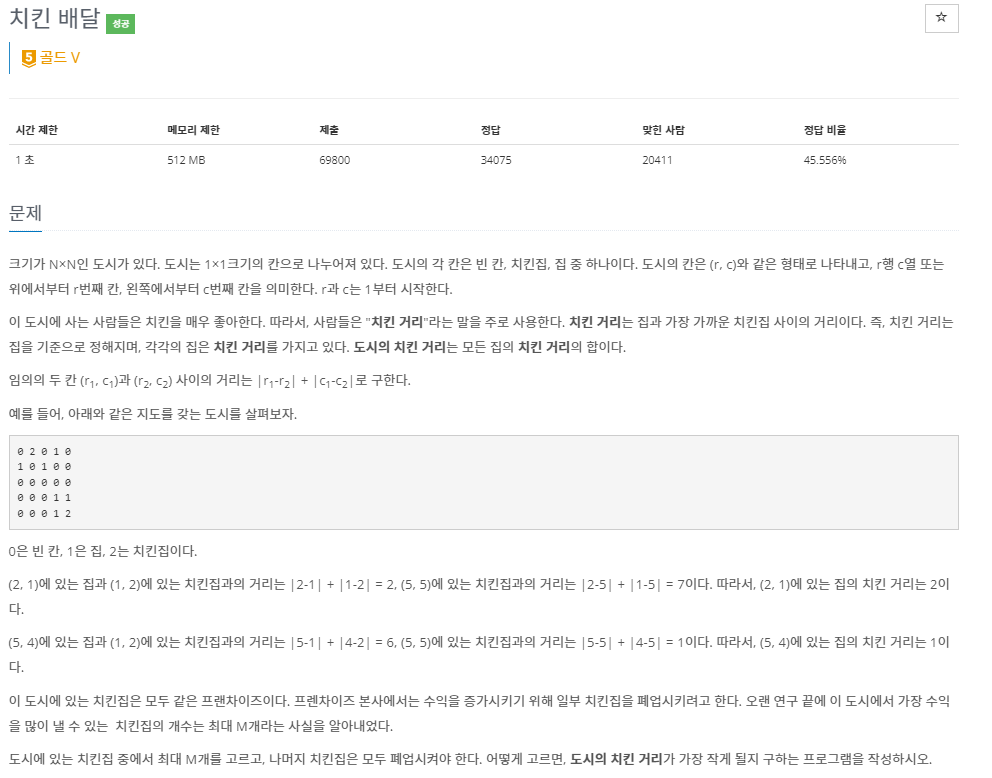

[상위 페이지 · 골드](/study/algorithms/search/gold/)

[https://www.acmicpc.net/problem/15686](https://www.acmicpc.net/problem/15686)



## 아이디어

이 문제는 조합으로 풀거나 백트래킹으로 풀거나 둘중에 하나지만 나는 백트래킹을 연습하기 위해 백트래킹으로 풀었다.

치킨집을 M개를 선택해 그 치킨 거리를 구한다음 매번 M개의 치킨집을 고를 때마다 최소값으로 갱신한다.

## 정답

```python
from collections import defaultdict

N,M = map(int,input().split())
graph = [list(map(int,input().split())) for _ in range(N)]

chicken = []
house = []

chicken_cnt = 0
for i in range(N):
    for j in range(N):
        if graph[i][j] == 2:
            chicken_cnt += 1
            chicken.append((chicken_cnt,(i+1,j+1)))
        elif graph[i][j] == 1:
            house.append((i+1,j+1))

visited = [False] * (chicken_cnt+1)
temp_list = []
answer = 1e10

def back_traack(count,num):
    global answer
    if count == M:
        temp_answer = 0
        for house_y, house_x in house:
            val = 1e10
            for num in temp_list:
                chicken_y,chicken_x = chicken[num-1][1]
                val = min(val, abs(chicken_y - house_y) + abs(chicken_x - house_x))
            temp_answer += val
        answer = min(answer, temp_answer)
        return
    for i in range(num,chicken_cnt+1):
        if not visited[i]:
            temp_list.append(i)
            visited[i] = True
            back_traack(count + 1,i+1)
            visited[i] = False
            temp_list.pop()
back_traack(0,1)

print(answer)
```
