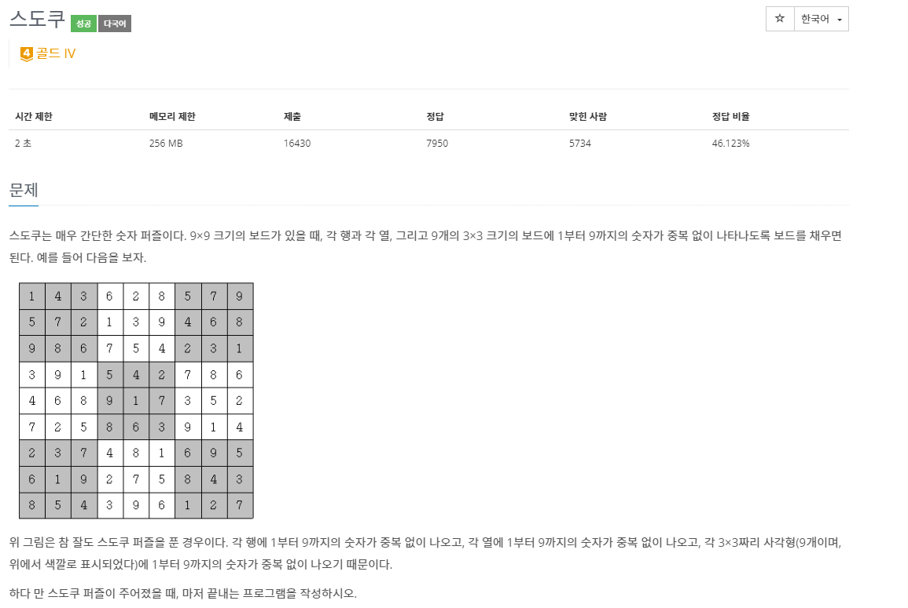

[상위 페이지 · 골드](/study/algorithms/search/gold/)

[https://www.acmicpc.net/problem/2239](https://www.acmicpc.net/problem/2239)



## 아이디어

스도쿠 빈칸에 따라 모든 조합을 넣어보며 재귀의 depth가 빈칸의 개수와 같아지면 graph를 출력한다.

그냥 간단하게 각 블럭, 가로, 세로마다 True,False나 리스트로 사용한 숫자를 체크해가며 백트래킹을 할 수 있지만 나는 비트마스킹을 연습하기 위해 비트마스킹을 사용 했다.

## 정답

```python
import sys

sys.setrecursionlimit(10 ** 6)
graph = [list(map(int,input())) for _ in range(9)]

# init
# 한 블럭 비트마스킹
one_block = [[0] * 3 for _ in range(3)]
for i in range(3):
    for j in range(3):
        num = 0
        for k in range(3):
            for l in range(3):
                if graph[k + (i*3)][l + (j*3)] != 0:
                    num |= (1<<graph[k + (i*3)][l + (j*3)])
        one_block[i][j] = num

# 가로 비트마스킹 + 빈칸 위치 찾기
horizontal = [0] * 9
zero_pos = []
blank_cnt = 0
for i in range(9):
    num = 0
    for j in range(9):
        if graph[i][j] == 0:
            blank_cnt += 1
            zero_pos.append((i,j))
        num |= (1<<graph[i][j])
    num ^= 1
    horizontal[i] = num

# 세로 비트마스킹
vertical = [0] * 9
for j in range(9):
    num = 0
    for i in range(9):
        num |= (1<<graph[i][j])
    num ^= 1
    vertical[j] = num

def back_track(depth):
    if depth == blank_cnt:
        for i in graph:
            print(*i,sep="")
        exit(0)
    y,x = zero_pos[depth]
    hor_num = horizontal[y]
    ver_num = vertical[x]
    block_num = one_block[y // 3][x // 3]
    for k in range(1, 10):
        if hor_num & (1<<k) == 0 and ver_num & (1<<k) == 0 and block_num & (1<<k) == 0:
            horizontal[y] = hor_num | (1 << k)
            vertical[x] = ver_num | (1 << k)
            one_block[y // 3][x // 3] = block_num | (1 << k)
            graph[y][x] = k
            back_track(depth + 1)
            graph[y][x] = 0
            horizontal[y] = hor_num ^ (0 << k)
            vertical[x] = ver_num ^ (0 << k)
            one_block[y // 3][x // 3] = block_num ^ (0 << k)
back_track(0)
```
