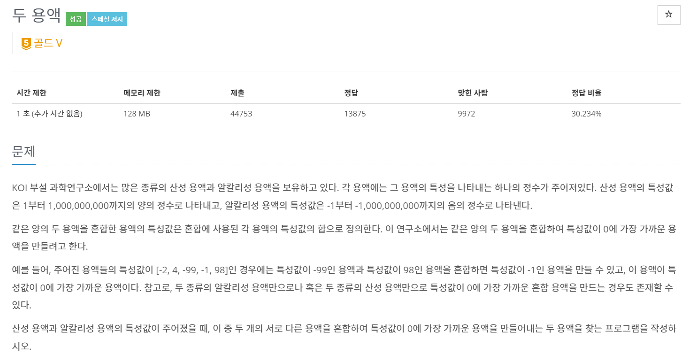
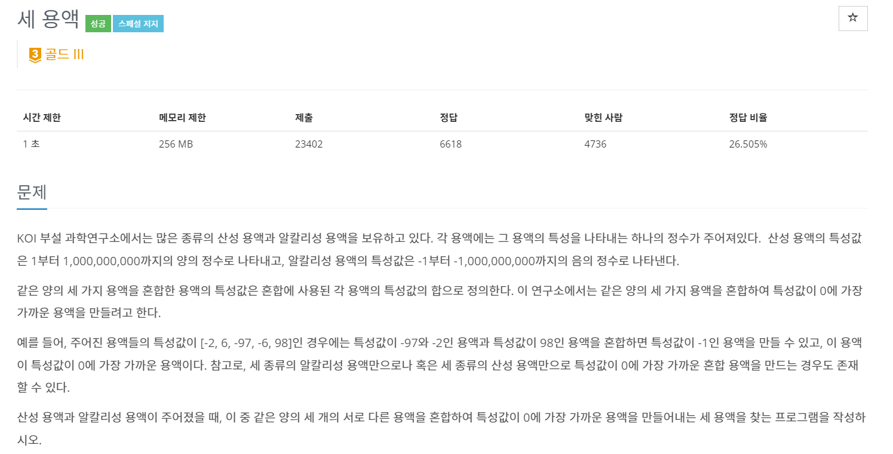

[상위 페이지 · 골드](/study/algorithms/search/gold/)

## 2470번 두 용액

[https://www.acmicpc.net/problem/2470](https://www.acmicpc.net/problem/2470)



## 아이디어

투 포인터를 사용하여 만약 두개의 값을 합친 값이 음수라면 왼쪽 포인터를 증가시키고 양수라면 오른쪽 포인터 값을 감소 시키며 최대한 0에 가까운 값을 찾는다.

## 정답

```python
N = int(input())
arr = list(map(int,input().split()))
arr.sort()
left,right = 0,N-1
min_sum = 1e12
answer = []
while left < right:
    sum = arr[left] + arr[right]

    if abs(sum) < min_sum:
        answer = [arr[left],arr[right]]
        min_sum = abs(sum)
    if sum == 0:
        break
    if sum < 0:
        left += 1
    else:
        right -= 1

print(*answer,sep=" ")
```

## 2473번 세 용액

[https://www.acmicpc.net/problem/2473](https://www.acmicpc.net/problem/2473)



## 아이디어

기본적으로 두 용액과 비슷한 맥락이지만 하나의 용액을 고정해두고 똑같이 투포인터 돌리면 된다.

## 정답

```python
N = int(input())
arr = list(map(int,input().split()))
arr.sort()
min_sum = 1e20
answer = []
for i in range(N-2):
    left = i+1
    right = N-1
  
    while left < right:
        sum = arr[left] + arr[right] + arr[i]

        if abs(sum) < min_sum:
            answer = [arr[i],arr[left],arr[right]]
            min_sum = abs(sum)
        if sum == 0:
            break
        if sum < 0:
            left += 1
        else:
            right -= 1

print(*sorted(answer),sep=" ")
```
