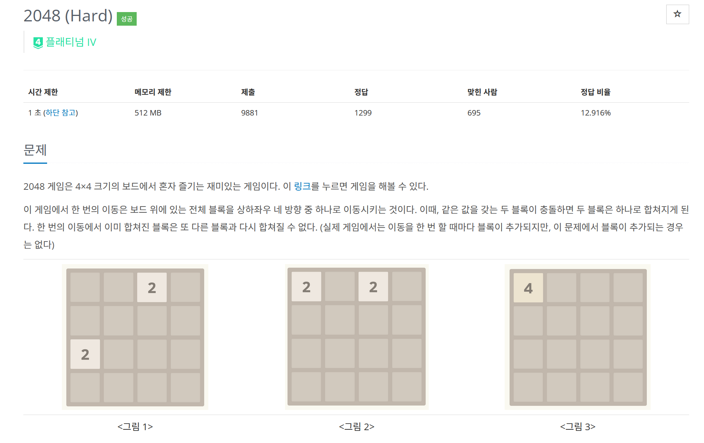
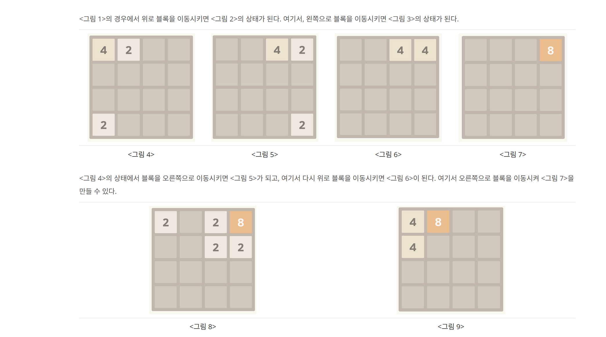
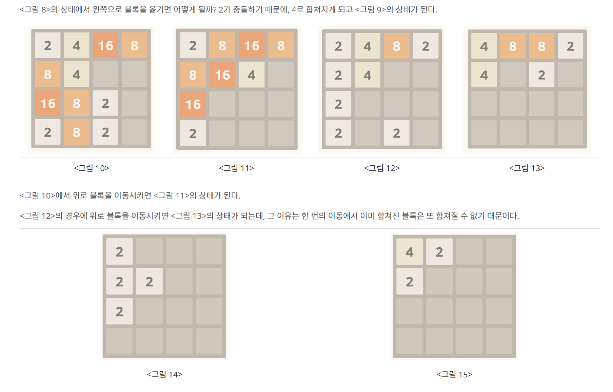
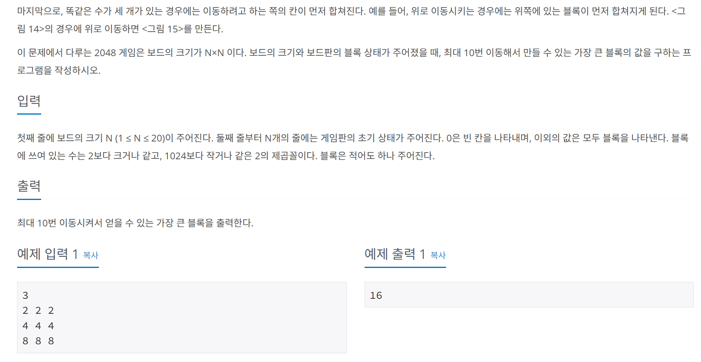

[상위 페이지 · Search](/study/algorithms/search/)









## 문제 태그

- 백트래킹
- 빡센 구현
- 약간의 메모이제이션
- 가지치기
- 비슷한 문제
    
    [12100번 2048(Easy)](/study/algorithms/search/gold/boj-12100/)
    

## 아이디어

[2048(Easy)](/study/algorithms/search/gold/boj-12100/) 와 동일하지만 깊이가 5에서 10으로 늘어났다 단순히 2배가된것이 아니라 연산량이 1000배 늘어나 최적화 기법 없이는 시간초과의 늪에서 벗어날 수 없다.

**최적화 기법**

1. 만약 상하좌우로 움직였을 때 보드의 변화가 없다면 더 이상 하위 리프를 순회 할 필요 없음
2. 상하좌우로 움직였을 때의 최대 값이 현재 깊이에서 만들어 질 수 있는 최대보다 낮다면 하위 리프를 순회 할 필요 없음
    1. 최대 깊이에 도달하면 dp배열에 dp[최대깊이]부터 //2를 하여 저장
    
    ```python
    max_num = 현재보드의 최대값
    for i in range(최대깊이, -1 ,-1):
    	dp[i] = max_num
    	max_num //= 2
    ```
    
    1. 만약 dp = {0,0,0,0,2,4,8,16,32,64,128}이고 깊이가 8이라면 상하좌우 움직인 보드에서 128은 나와야 최대값 갱신이 가능한것.
3. 상하좌우 움직임을 큐스택 활용하여 구현

## 정답

```python
import sys
sys.setrecursionlimit(10**5)
N = int(input())
graph = [list(map(int, input().split())) for _ in range(N)]
answer = 0
dp = [0] * 11

def move_right(graph):
    max_val = 0
    for i in range(N):
        visited = [False] * N
        temp = [0] * N
        size = -1
        for j in range(N-1, -1, -1):
            if graph[i][j] == 0:
                continue
            if size != -1 and temp[size] == graph[i][j] and not visited[size]:
                temp[size] *= 2
                visited[size] = True
            else:
                size += 1
                temp[size] = graph[i][j]
        temp.reverse()
        graph[i] = temp
        max_val = max(max_val, max(temp))
    return max_val

def move_left(graph):
    max_val = 0
    for i in range(N):
        visited = [False] * N
        temp = [0] * N
        size = -1
        for j in range(N):
            if graph[i][j] == 0:
                continue
            if size != -1 and temp[size] == graph[i][j] and not visited[size]:
                temp[size] *= 2
                visited[size] = True
            else:
                size += 1
                temp[size] = graph[i][j]
        graph[i] = temp
        max_val = max(max_val, max(temp))
    return max_val

def move_up(graph):
    max_val = 0
    for j in range(N):
        visited = [False] * N
        temp = [0] * N
        size = -1
        for i in range(N):
            if graph[i][j] == 0:
                continue
            if size != -1 and temp[size] == graph[i][j] and not visited[size]:
                temp[size] *= 2
                visited[size] = True
            else:
                size += 1
                temp[size] = graph[i][j]
        for i in range(N):
            graph[i][j] = temp[i]
            max_val = max(max_val, temp[i])
    return max_val

def move_down(graph):
    max_val = 0
    for j in range(N):
        visited = [False] * N
        temp = [0] * N
        size = -1
        for i in range(N-1, -1, -1):
            if graph[i][j] == 0:
                continue
            if size != -1 and temp[size] == graph[i][j] and not visited[size]:
                temp[size] *= 2
                visited[size] = True
            else:
                size += 1
                temp[size] = graph[i][j]
        temp.reverse()
        for i in range(N):
            graph[i][j] = temp[i]
            max_val = max(max_val, temp[i])
    return max_val

event = [move_up, move_down, move_right, move_left]

def back_track(graph,depth,max_graph):
    global answer
    if depth == 10:
        if answer < max_graph:
            answer = max_graph
            for i in range(10, -1, -1):
                dp[i] = max_graph
                max_graph //= 2
        return

    for i in range(4):
        previous_graph = [row[:] for row in graph]
        max_after_move = event[i](previous_graph)
        if graph == previous_graph:
            continue
        if max_after_move < dp[depth + 1]:
            continue
        back_track(previous_graph,depth + 1,max_after_move)
if N == 1:
    print(graph[0][0])
    exit()
back_track(graph,0,0)
print(answer)

```

 파이썬은 느려서 정답이 나오지 않음 추가적인 최적화 기법이 필요하다는것에서 불공평함을 느낌.

동일 로직 자바로 작성 후 정답

```java
import java.util.*;

public class Main {
    static int N;
    static int[][] graph;
    static int answer = 0;
    static int[] dp = new int[11];
    static final int MAX_DEPTH = 10;

    public static void main(String[] args) {
        Scanner sc = new Scanner(System.in);
        N = sc.nextInt();
        graph = new int[N][N];
        for (int i = 0; i < N; i++) 
            for (int j = 0; j < N; j++) 
                graph[i][j] = sc.nextInt();
        if(N == 1){
            System.out.println(graph[0][0]);
            return;
        }
        backTrack(graph, 0, 0);
        System.out.println(answer);
    }

    // 깊이 우선 탐색
    static void backTrack(int[][] board, int depth, int maxVal) {
        if (depth == MAX_DEPTH) {
            if (answer < maxVal) {
                answer = maxVal;
                for (int i = MAX_DEPTH; i >= 0; i--) {
                    dp[i] = maxVal;
                    maxVal /= 2;
                }
            }
            return;
        }

        for (int i = 0; i < 4; i++) {
            int[][] copied = copy(board);
            int newMax = 0;

            switch (i) {
                case 0: newMax = moveUp(copied); break;
                case 1: newMax = moveDown(copied); break;
                case 2: newMax = moveRight(copied); break;
                case 3: newMax = moveLeft(copied); break;
            }

            if (isSame(board, copied)) continue;
            if (newMax < dp[depth + 1]) continue;

            backTrack(copied, depth + 1, newMax);
        }
    }

    // 오른쪽 이동
    static int moveRight(int[][] board) {
        int max = 0;
        for (int i = 0; i < N; i++) {
            boolean[] visited = new boolean[N];
            int[] temp = new int[N];
            int size = -1;

            for (int j = N - 1; j >= 0; j--) {
                if (board[i][j] == 0) continue;
                if (size != -1 && temp[size] == board[i][j] && !visited[size]) {
                    temp[size] *= 2;
                    visited[size] = true;
                } else {
                    temp[++size] = board[i][j];
                }
            }

            for (int j = 0; j < N; j++)
                board[i][j] = 0;

            for (int j = 0; j <= size; j++)
                board[i][N - 1 - j] = temp[j];

            max = Math.max(max, Arrays.stream(temp).max().orElse(0));
        }
        return max;
    }

    // 왼쪽 이동
    static int moveLeft(int[][] board) {
        int max = 0;
        for (int i = 0; i < N; i++) {
            boolean[] visited = new boolean[N];
            int[] temp = new int[N];
            int size = -1;

            for (int j = 0; j < N; j++) {
                if (board[i][j] == 0) continue;
                if (size != -1 && temp[size] == board[i][j] && !visited[size]) {
                    temp[size] *= 2;
                    visited[size] = true;
                } else {
                    temp[++size] = board[i][j];
                }
            }

            for (int j = 0; j < N; j++)
                board[i][j] = (j <= size) ? temp[j] : 0;

            max = Math.max(max, Arrays.stream(temp).max().orElse(0));
        }
        return max;
    }

    // 위쪽 이동
    static int moveUp(int[][] board) {
        int max = 0;
        for (int j = 0; j < N; j++) {
            boolean[] visited = new boolean[N];
            int[] temp = new int[N];
            int size = -1;

            for (int i = 0; i < N; i++) {
                if (board[i][j] == 0) continue;
                if (size != -1 && temp[size] == board[i][j] && !visited[size]) {
                    temp[size] *= 2;
                    visited[size] = true;
                } else {
                    temp[++size] = board[i][j];
                }
            }

            for (int i = 0; i < N; i++)
                board[i][j] = (i <= size) ? temp[i] : 0;

            max = Math.max(max, Arrays.stream(temp).max().orElse(0));
        }
        return max;
    }

    // 아래쪽 이동
    static int moveDown(int[][] board) {
        int max = 0;
        for (int j = 0; j < N; j++) {
            boolean[] visited = new boolean[N];
            int[] temp = new int[N];
            int size = -1;

            for (int i = N - 1; i >= 0; i--) {
                if (board[i][j] == 0) continue;
                if (size != -1 && temp[size] == board[i][j] && !visited[size]) {
                    temp[size] *= 2;
                    visited[size] = true;
                } else {
                    temp[++size] = board[i][j];
                }
            }

            for (int i = 0; i < N; i++)
                board[i][j] = 0;

            for (int i = 0; i <= size; i++)
                board[N - 1 - i][j] = temp[i];

            max = Math.max(max, Arrays.stream(temp).max().orElse(0));
        }
        return max;
    }

    // 그래프 복사
    static int[][] copy(int[][] src) {
        int[][] result = new int[N][N];
        for (int i = 0; i < N; i++)
            System.arraycopy(src[i], 0, result[i], 0, N);
        return result;
    }

    // 그래프 비교
    static boolean isSame(int[][] a, int[][] b) {
        for (int i = 0; i < N; i++){
            for (int j = 0; j < N; j++){
                if(a[i][j] != b[i][j]) return false;
            }
        }
        return true;
    }
}

```
