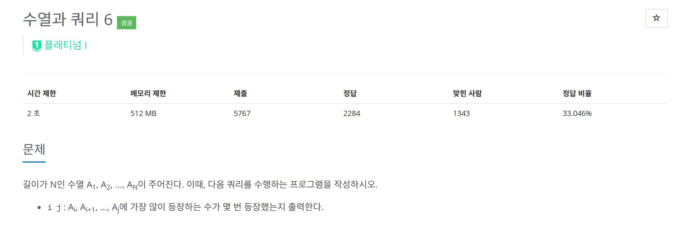

[상위 페이지 · 플래티넘](/study/algorithms/search/platinum/)



## 문제 태그

- 오프라인 쿼리
- Mo’s 알고리즘

## 아이디어

1. Mo’s 알고리즘으로 풀면된다. 간단하게 설명하면
    1. 쿼리를 x,y순으로 정렬해서 중복된 구간은 또 구하지 않게 하는것이다. 약간 투포인터의 느낌

## 정답

```python
from math import sqrt
from collections import defaultdict

def mos_algorithm(arr, queries):
    n = len(arr)
    block_size = int(sqrt(n))
    queries = sorted(queries, key=lambda x: (x[0] // block_size, x[1]))

    result = [0] * len(queries)
    freq = defaultdict(int)
    count_freq = defaultdict(int)
    max_freq = 0

    currL, currR = 0, -1

    def add(x):
        nonlocal max_freq
        count_freq[freq[x]] -= 1
        freq[x] += 1
        count_freq[freq[x]] += 1
        max_freq = max(max_freq, freq[x])

    def remove(x):
        nonlocal max_freq
        count_freq[freq[x]] -= 1
        if count_freq[freq[x]] == 0 and freq[x] == max_freq:
            max_freq -= 1
        freq[x] -= 1
        count_freq[freq[x]] += 1

    for L, R, idx in queries:
        while currL > L:
            currL -= 1
            add(arr[currL])
        while currR < R:
            currR += 1
            add(arr[currR])
        while currL < L:
            remove(arr[currL])
            currL += 1
        while currR > R:
            remove(arr[currR])
            currR -= 1
        result[idx] = max_freq
    return result

# 입력 처리
n = int(input())
arr = list(map(int, input().split()))
m = int(input())
queries = []
for i in range(m):
    l, r = map(int, input().split())
    queries.append((l - 1, r - 1, i))

result = mos_algorithm(arr, queries)
for r in result:
    print(r)

```
