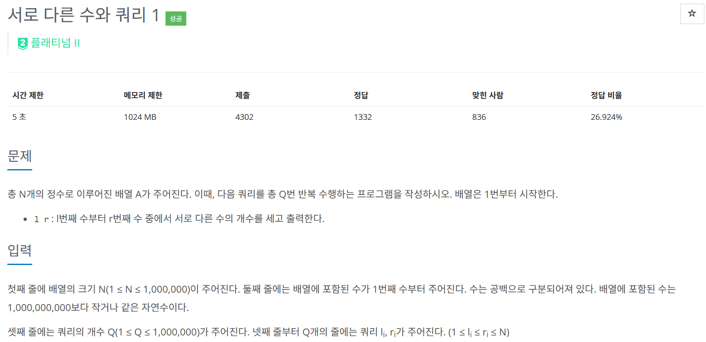

[상위 페이지 · 플래티넘](/study/algorithms/search/platinum/)



## 문제 태그

- 오프라인 쿼리
- 좌표 압축
- mo’s 알고리즘

## 아이디어

1. 이 문제는 일반적인 mo's 알고리즘과 유사하나, 배열에 포함된 자연수 값이 매우 큰 것이 특징이다. 이로 인해 개수를 셀 때 문제가 발생할 수 있어 좌표 압축을 통해 해결한다.
    1. 예) 5000000, 2, 5000000, 1
        
        딕셔너리 1 : 0, 2:1, 5000000:2을 만들고 arr에는 2,1,2,0을 넣는다
        

## 정답

```python
import sys
from math import sqrt
input = sys.stdin.readline

N = int(input())
arr = list(map(int, input().split()))

compressed = {val: idx for idx, val in enumerate(sorted(set(arr)))}
arr = [compressed[val] for val in arr]
MAX_VAL = len(compressed)

Q = int(input())
queries = []
for i in range(Q):
    l, r = map(int, input().split())
    queries.append((l - 1, r - 1, i))

block_size = int(sqrt(N)) + 1
queries.sort(key=lambda x: (x[0] // block_size, x[1] if (x[0] // block_size) % 2 == 0 else -x[1]))

freq = [0] * MAX_VAL
result = [0] * Q
unique = 0
l, r = 0, -1

for ql, qr, idx in queries:
    while l > ql:
        l -= 1
        freq[arr[l]] += 1
        if freq[arr[l]] == 1:
            unique += 1
    while r < qr:
        r += 1
        freq[arr[r]] += 1
        if freq[arr[r]] == 1:
            unique += 1
    while l < ql:
        freq[arr[l]] -= 1
        if freq[arr[l]] == 0:
            unique -= 1
        l += 1
    while r > qr:
        freq[arr[r]] -= 1
        if freq[arr[r]] == 0:
            unique -= 1
        r -= 1
    result[idx] = unique

print('\n'.join(map(str, result)) + '\n')

```
