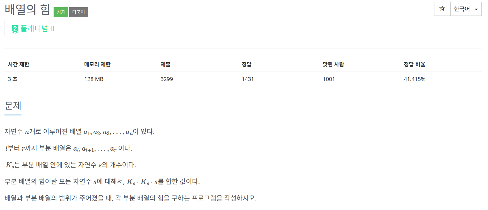

[상위 페이지 · 플래티넘](/study/algorithms/search/platinum/)



## 문제 태그

- 오프라인 쿼리
- mo’s 알고리즘

## 아이디어

1. 모스 알고리즘대로 쿼리를 정렬 해 준 다음
2. 더하는건 v = 현숫자 $$(2k_v + 1)  *v$$ 빼는건 $$(-2k_v+1)*v$$

## 정답

```python
import sys, math
input = sys.stdin.readline

n, t = map(int, input().split())
arr = list(map(int, input().split()))
block = int(math.sqrt(n))

queries = []
for i in range(t):
    query_l, query_r = map(int, input().split())
    query_l -= 1; query_r -= 1
    queries.append((query_l, query_r, i))

queries.sort(key=lambda x: (x[0]// block, x[1] if x[0]// block % 2 == 0 else -x[1]))

res = [0] * t
cnt = [0] * (10**6 + 1)
curr = 0
l, r = 0, -1

for query_l, query_r, idx in queries:
    while l > query_l:
        l -= 1
        v = arr[l]; k = cnt[v]
        curr += (2*k + 1) * v
        cnt[v] += 1
    while r < query_r:
        r += 1
        v = arr[r]; k = cnt[v]
        curr += (2*k + 1) * v
        cnt[v] += 1
    while l < query_l:
        v = arr[l]; k = cnt[v]
        curr += (-2*k + 1) * v
        cnt[v] -= 1
        l += 1
    while r > query_r:
        v = arr[r]; k = cnt[v]
        curr += (-2*k + 1) * v
        cnt[v] -= 1
        r -= 1
    res[idx] = curr

print("\n".join(map(str, res)))

```
