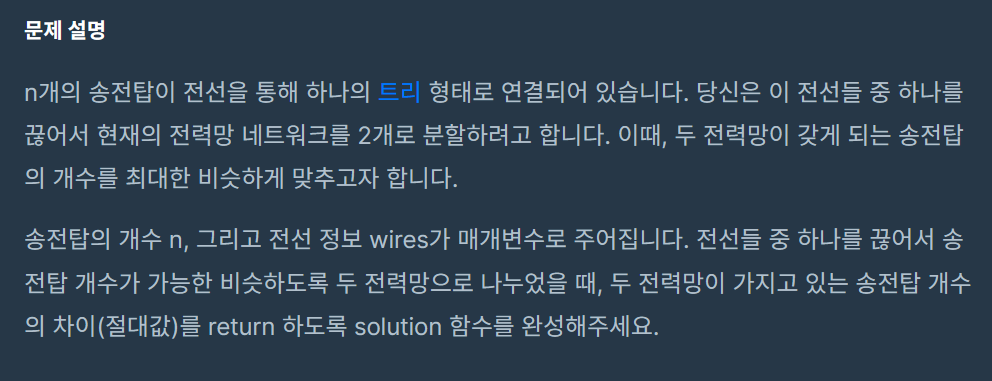

[상위 페이지 · 실버/레벨2](/study/algorithms/search/silver-level-2/)



## 문제 태그

- 유니온 파인드
- 브루트 포스

## 아이디어

1. 브루트포스로 하나의 전력망을 끊는다
2. 유니온 파인드를 통해 각 집합으로 만들어서 집합의 요소를 센다
3. 그 중 차이가 가장 큰 것을 저장

## 정답

```python
class Union():
    def __init__(self, n):
        self.parent = [i for i in range(n)]
        
    def find(self, x):
        if self.parent[x] != x:
            self.parent[x] = self.find(self.parent[x])
        return self.parent[x]
    
    def union(self, x, y):
        x_root = self.find(x)
        y_root = self.find(y)

        if x_root != y_root:
            self.parent[x_root] = y_root
            
    def arrangement(self):
        for i in range(len(self.parent)):
            self.find(i)
            
def solution(n, wires):
    answer = 999999999999
    for i in range(n-1):
        unionc = Union(n+1)
        for j in range(n-1):
            if i == j:
                continue
            unionc.union(wires[j][0],wires[j][1])
        unionc.arrangement()
        temp_set = list(set(unionc.parent[1:]))
        answer = min(answer, abs(unionc.parent.count(temp_set[0]) - unionc.parent.count(temp_set[1])))
    return answer
```
