[상위 페이지 · 알고리즘](/study/algorithms/)

정렬이란 주어진 데이터를 크기 순서대로 또는 일정한 기준에 따라 정리하는 것을 말한다.
정렬은 데이터를 검색하거나 비교할 때 효율적으로 처리하기 위해 필요하다.

## 선택 정렬

선택 정렬은 주어진 리스트에서 가장 작은 값을 찾아서 맨 앞의 위치와 교환하고, 그 다음 작은 값을 찾아서 두 번째 위치와 교환하는 과정을 반복하여 정렬을 완성하는 알고리즘이다.

선택 정렬은 구현이 간단하며, 정렬이 필요한 데이터 수가 적을 때는 효율적인 알고리즘이지만, 데이터 수가 많아질수록 성능이 떨어진다.

선택 정렬의 시간 복잡도는 $$O(n^2)$$이다.

### 선택 정렬의 과정

1. 주어진 리스트에서 가장 작은 값을 찾는다.
2. 가장 작은 값과 맨 앞의 값을 교환한다.
3. 리스트의 남은 값들 중 가장 작은 값을 찾아서 두 번째 위치와 교환한다.
4. 2-3번 과정을 리스트의 마지막 값까지 반복한다.

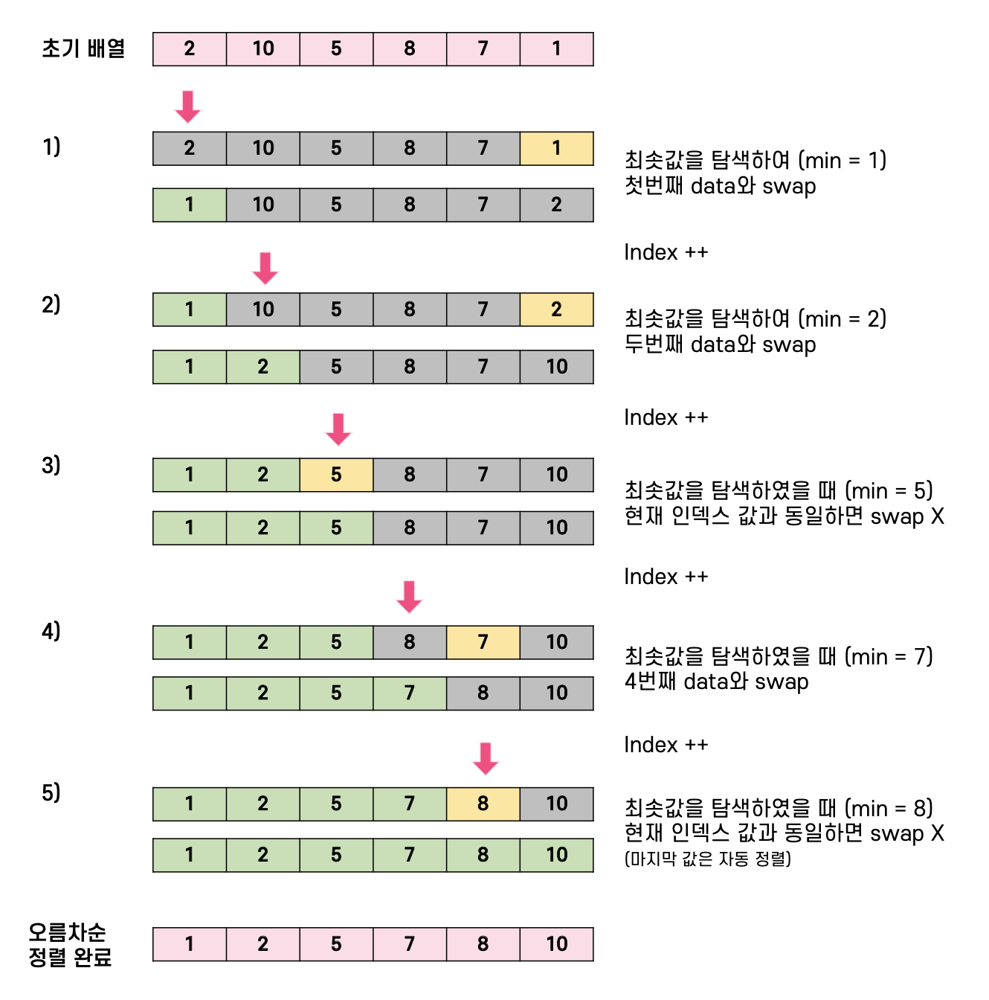

### 선택 정렬의 장단점

**장점**

- 구현하기 쉽다.
- 정렬이 필요한 데이터 수가 적을 때는 효율적인 알고리즘이다.

**단점**

- 데이터 수가 많아질수록 성능이 떨어진다.
- 시간 복잡도는 $$O(n^2)$$으로, 대규모 데이터에서는 느리다.
- 안정성이 보장되지 않는다.

## 버블 정렬

버블 정렬은 인접한 두 수를 비교하여 작은 수를 왼쪽으로, 큰 수를 오른쪽으로 이동시키는 정렬 알고리즘이다.

버블 정렬은 구현이 간단하며, 알고리즘이 직관적이기 때문에 이해하기 쉽다. 하지만 성능이 좋지 않아 대규모 데이터에서는 사용되지 않는다.

버블 정렬의 시간 복잡도는 $$O(n^2)$$이다.

### 버블 정렬의 과정

1. 리스트의 첫 번째 값과 두 번째 값을 비교하여 더 작은 값을 왼쪽으로 이동시킨다.
2. 두 번째 값과 세 번째 값을 비교하여 더 작은 값을 왼쪽으로 이동시킨다.
3. 이 과정을 리스트의 끝까지 반복한다.
4. 위의 과정을 리스트의 끝까지 반복하면서, 가장 큰 값이 리스트의 맨 오른쪽으로 이동한다.
5. 1-4번 과정을 리스트의 끝에서부터 다시 반복한다.
6. 리스트가 정렬될 때까지 1-5번 과정을 반복한다.

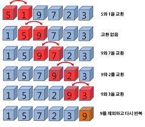

### 버블 정렬의 장단점

**장점**

- 구현하기 쉽다.
- 알고리즘이 직관적이기 때문에 이해하기 쉽다.
- 일반적인 인접 교환 구현에서는 안정 정렬이다.

**단점**

- 대규모 데이터에서는 성능이 좋지 않다.
- 시간 복잡도는 $$O(n^2)$$으로, 대규모 데이터에서는 느리다.

### 버블 정렬 시뮬레이션

[https://codepen.io/Creeper0809/pen/pvjrWYp](https://codepen.io/Creeper0809/pen/pvjrWYp)

## 삽입 정렬

삽입 정렬은 주어진 리스트를 정렬된 부분과 정렬되지 않은 부분으로 나누어, 정렬되지 않은 부분에서 하나씩 원소를 선택하여 정렬된 부분에 삽입하는 방식으로 정렬을 수행하는 알고리즘이다.

삽입 정렬은 선택 정렬·버블 정렬보다 실전에서 유리한 경우가 많지만, 평균/최악에는 O(n^2)이므로 대규모 데이터에서는 비효율적일 수 있다.

삽입 정렬의 시간 복잡도는 $$O(n^2)$$이다.

### 삽입 정렬의 과정

1. 리스트의 두 번째 값부터 시작하여, 그 값보다 왼쪽의 값들과 비교하여 자신이 들어갈 위치를 찾는다.
2. 해당 위치에 새로운 값을 삽입한다.
3. 1-2번 과정을 리스트의 끝까지 반복한다.

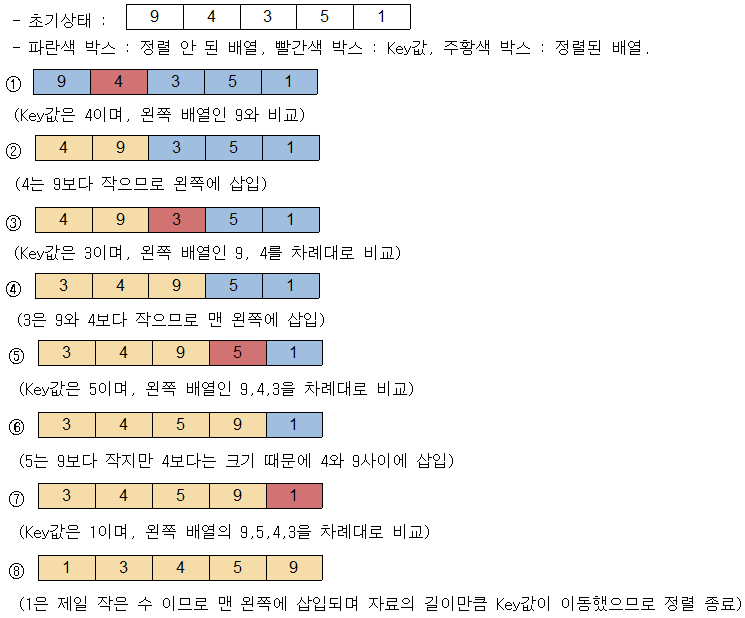

### 삽입 정렬의 장단점

**장점**

- 구현이 단순하고, 이미 정렬이 많이 된 입력에서 매우 효율적이다.
- 안정 정렬이다.

**단점**

- 평균/최악 시간 복잡도는 $$O(n^2)$$으로 데이터가 많아질수록 비효율적이다.

## 병합 정렬

병합 정렬은 분할 정복 알고리즘의 하나로, 리스트를 반으로 나눈 후 각각을 재귀적으로 정렬하고, 두 리스트를 다시 합병하여 정렬된 리스트를 만드는 알고리즘이다.

합병 정렬은 안정적인 정렬 방법으로, 대규모 데이터에서도 효율적으로 동작한다. 하지만 리스트를 분할하는 과정에서 추가적인 메모리가 필요하기 때문에 메모리 사용량이 높다는 단점이 있다.

합병 정렬의 시간 복잡도는 $$O(n \log n)$$이다.

### 합병 정렬의 과정

1. 리스트의 길이가 0 또는 1이면 이미 정렬된 것으로 본다.
2. 그렇지 않은 경우에는 리스트를 반으로 나눈다.
3. 각 부분 리스트를 재귀적으로 합병 정렬을 이용하여 정렬한다.
4. 두 부분 리스트를 다시 합병하여 정렬된 리스트를 만든다.

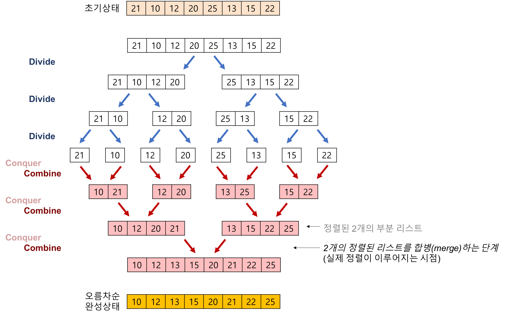

### 합병 정렬의 장단점

**장점**

- 안정적인 정렬 방법으로, 대규모 데이터에서도 효율적으로 동작한다.
- 분할 정복 방법을 이용하므로, 재귀 호출을 이용한 구현이 가능하다.
- 퀵 정렬과 달리 기준값을 설정하는 과정없이 무조건 절반으로 분할하기에 기준값에 따라 성능이 달라지는 경우가 없다.

**단점**

- 리스트를 분할하는 과정에서 추가적인 메모리가 필요하다.
- 추가적인 메모리를 할당할 수 없다면 합병정렬을 사용할 수 없다

## 퀵 정렬

퀵 정렬은 기준값(pivot)을 기준으로 작은 값은 왼쪽, 큰 값은 오른쪽으로 나누어 정렬하는 알고리즘이다.

퀵 정렬은 대부분의 데이터에서 빠르게 동작하며, 대규모 데이터를 정렬하기에 적합하다. 하지만 최악의 경우 시간 복잡도가 $$O(n^2)$$이므로 이에 대한 대책이 필요하다.

### 퀵 정렬의 과정

1. 리스트에서 기준값(pivot)을 선택한다.
2. 리스트를 기준값을 기준으로 작은 값은 왼쪽, 큰 값은 오른쪽으로 나눈다.
3. 왼쪽 리스트와 오른쪽 리스트를 각각 퀵 정렬을 이용하여 정렬한다.
4. 왼쪽 리스트와 오른쪽 리스트를 합친다.

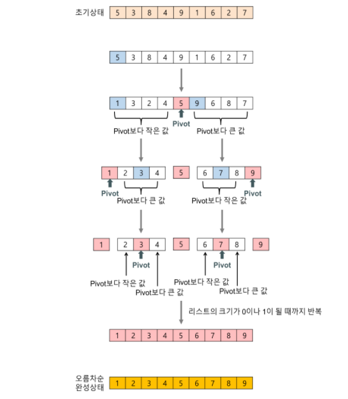

### 퀵 정렬의 장단점

**장점**

- 대부분의 데이터에서 빠르게 동작한다.
- 대규모 데이터를 정렬하기에 적합하다.

**단점**

- 기준값을 이상적인 값으로 선택했다면$$N \times logN$$의 시간복잡도를 가지지만 최악의 기준값을 가지게 되는 경우 시간 복잡도가 $$O(n^2)$$이다.
- 안정성이 보장되지 않는다.

## 힙 정렬

힙 정렬은 힙 자료구조를 이용하여 정렬하는 알고리즘이다.

힙이란 완전 이진 트리의 일종으로, 모든 노드가 자식 노드보다 작은(또는 큰) 값을 가지는 이진 트리를 말한다. 이진 트리는 자식 노드가 두 개인 반면, 힙은 최대 또는 최소 값을 찾기 위해 자식 노드와 부모 노드의 관계를 이용하여 구현된다.

힙 정렬은 성능이 좋은 정렬 알고리즘 중 하나로, 시간 복잡도는 $$O(n \log n)$$이다.

### 힙 정렬의 과정

1. 정렬할 리스트를 힙으로 변환한다.
2. 최대(최소)값을 추출하여 정렬된 리스트에 추가한다.
3. 1-2번 과정을 반복한다.

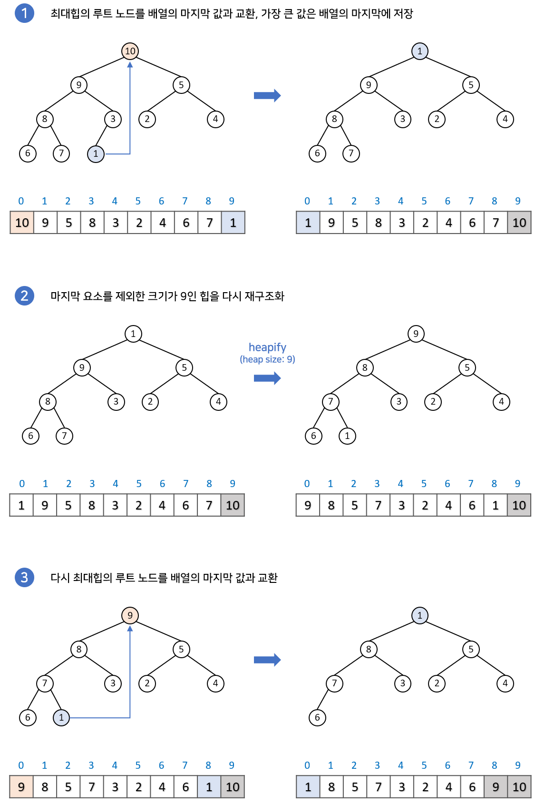

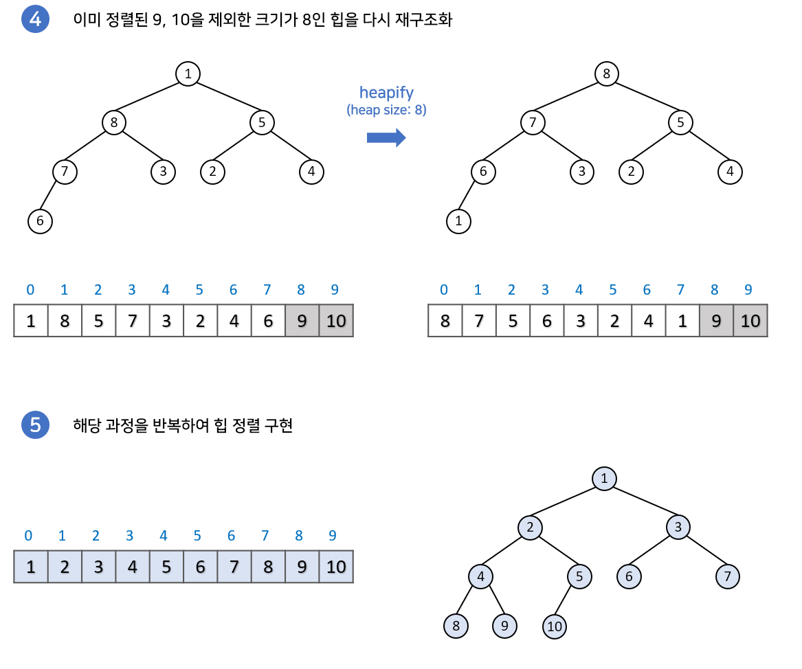

### 힙 정렬의 장단점

**장점**

- 추가적인 메모리를 필요로하지 않는다
- 성능이 좋은 정렬 알고리즘이다.
- 시간 복잡도는 $$O(n \log n)$$이다.

**단점**

- 이상적인 경우에 퀵정렬과 비교했을 때 똑같이 $$O(n \log n)$$ 이 나오긴 하나 실제 시간을 측정하면퀵정렬보다 느리다고 한다. 즉, 데이터의 상태에 따라서 다른 정렬들에 비해서 조금 느린편이다.
- 안정성이 보장되지 않는다.

## 계수 정렬

계수 정렬은 정수 형태로 표현할 수 있는 자료에 대해서만 적용할 수 있는 비교 기반 정렬 알고리즘이 아니며, 데이터의 크기 범위가 제한되어 있을 때만 사용 가능하다.

계수 정렬은 데이터의 개수가 N, 데이터(양수) 중 최댓값이 K일 때, 최악의 경우에도 수행 시간이 O(N+K)를 보장한다.

### 계수 정렬의 조건

1. 리스트 내의 모든 원소들은 0~K(k는 정수)의 범위를 가져야만 한다. 음수나 소수가 있으면 사용 불가
2. k = O(N)으로 나타낼 수 있어야만 한다

### 계수 정렬의 과정

1. 데이터의 값과 동일한 인덱스의 값에 1을 더한다.
2. 누적합을 계산한다.
3. 데이터를 뒤에서부터 순회하며, 누적합의 인덱스에 해당하는 위치에 데이터를 삽입한다.
4. 2-3번 과정을 반복한다.

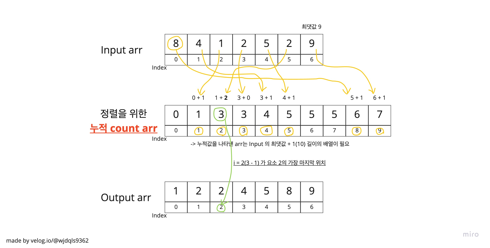

### 계수 정렬의 장단점

**장점**

- 비교 기반 정렬 알고리즘보다 빠르다.
- 데이터의 크기가 한정되어 있을 때 사용 가능하다.

**단점**

- 데이터의 크기가 너무 크면 만들어야 하는 배열의 크기가 크므로 메모리의 낭비가 심하다.
- 데이터가 정수 형태로 표현할 수 있어야 한다.
- 안정성이 보장되지 않는다.

## 기수 정렬

기수 정렬은 자리 수를 기준으로 정렬하는 알고리즘이다. 모든 숫자는 같은 자리수를 가지고 있어야 하고, 각 자리수는 0~9의 숫자로 표현할 수 있어야 한다.

기수 정렬은 비교 기반 정렬 알고리즘이 아니므로, 데이터의 크기와 상관없이 모든 경우에 시간 복잡도는 $$O(d(n+k))$$이다. 이 때, d는 최대 자리수, n은 데이터의 개수, k는 진수(10진수일 경우 k=10)를 의미한다.

### 기수 정렬의 과정

1. 각 자리수를 기준으로 데이터를 정렬한다.
2. 가장 낮은 자리수부터 가장 높은 자리수까지 위의 과정을 반복한다.

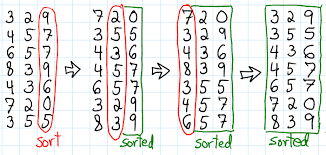

### 기수 정렬의 장단점

**장점**

- 데이터의 크기와 상관없이 모든 경우에 시간 복잡도는 $$O(d(n+k))$$이다.
- 문자열도 정렬이 가능하다
- 안정성이 보장된다.

**단점**

- 진수를 바꾸는 경우에는 기수 정렬을 다시 수행해야 한다.
- 데이터의 자리수가 길어질수록 메모리 사용량이 많아진다.
- 데이터의 자리수에 따라 연산 횟수가 크게 차이나므로, 자리수에 따른 최적의 진수를 구해야 한다.

## 쉘 정렬

쉘 정렬은 삽입 정렬의 특징을 이용하여 데이터의 묶음 단위로 삽입 정렬을 수행하는 알고리즘이다. 삽입 정렬이 첫번째 원소부터 시작하여 살펴보았다면, 쉘 정렬은 첫번째 원소, 두번째 원소, 세번째 원소... 이렇게 묶음 단위로 살펴보는 것이다.

### 쉘 정렬의 과정

1. 묶음 단위를 먼저 정해준다.
2. 정해진 묶음 단위에 따라 데이터를 묶어준다.
3. 묶인 데이터를 삽입 정렬로 정렬한다.
4. 묶음 단위를 줄여가며 정렬을 반복한다.

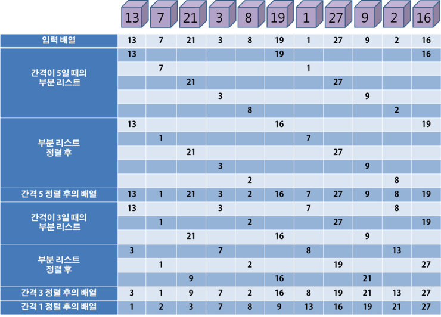

### 쉘 정렬의 장단점

**장점**

- 삽입 정렬의 단점을 개선한 알고리즘이다.
- 평균적으로 빠른 속도를 가진다.

**단점**

- 묶음의 크기에 따라 성능이 달라질 수 있다.
- 안정성이 보장되지 않는다.
- 삽입 정렬과 마찬가지로 데이터의 양이 많을 경우 비효율적일 수 있다.

## 전체 정렬 알고리즘 속도 비교

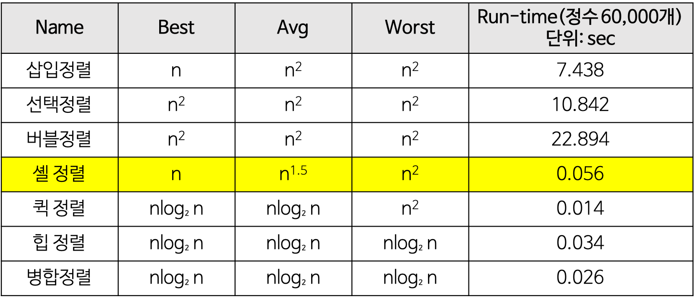

## 문제 풀이

- [12771. Oil](/study/algorithms/sorting/platinum/boj-12771/)

- [18870. **좌표 압축**](/study/algorithms/sorting/silver/boj-18870/)
