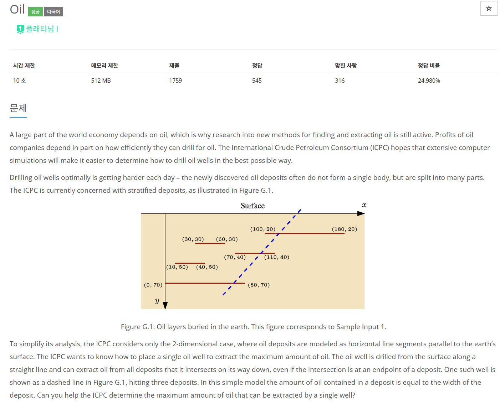
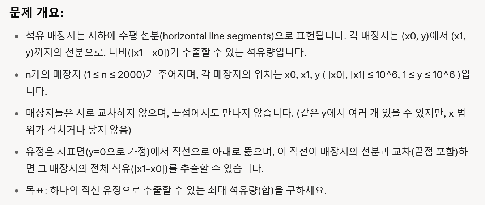

[상위 페이지 · 플레티넘](/study/algorithms/sorting/platinum/)



## 문제 해석



## 문제 태그

- 정렬
- 기하학
- 스위핑
- 각도 정렬

## 아이디어

- 각 모든 끝점을 기준점으로 선택
- 모든 기준점에 대해 다른 매장지들의 기울기를 계산
- sweeping으로 기울기  축에서 최대 중첩 합 계산
- 수직선은 별도 게산

## 정답(C++ 포팅 해야함)

```python
from fractions import Fraction
import sys

input = sys.stdin.readline

n = int(input())
segments = []
for _ in range(n):
    x0, x1, y = map(int, input().split())
    l = min(x0, x1)
    r = max(x0, x1)
    w = r - l
    segments.append((l, r, y, w))

points = []
for i in range(n):
    l, r, y, w = segments[i]
    points.append((l, y, i))
    points.append((r, y, i))

answer = 0

for p in points:
    px, py, seg_id = p
    base = 0
    intervals = []
    vert_sum = 0
    for j in range(n):
        l, r, y, w = segments[j]
        if l <= px <= r:
            vert_sum += w
        dy = y - py
        if dy == 0:
            if l <= px <= r:
                base += w
            continue
        sl = Fraction(l - px, dy)
        sr = Fraction(r - px, dy)
        left = min(sl, sr)
        right = max(sl, sr)
        intervals.append((left, right, w))
    events = []
    for left, right, w in intervals:
        events.append((left, 0, w))
        events.append((right, 1, -w))
    events.sort(key=lambda e: (e[0], e[1]))
    current = base
    local_max = current
    for _, _, delta in events:
        current += delta
        local_max = max(local_max, current)
    local_max = max(local_max, vert_sum)
    answer = max(answer, local_max)

print(answer)
```
