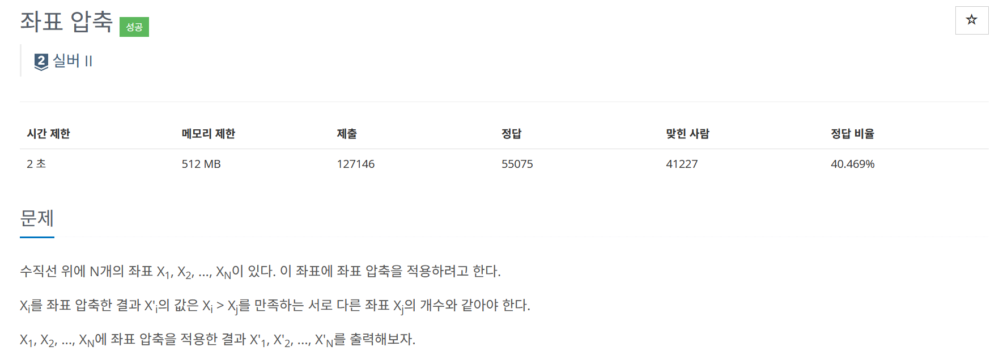

[상위 페이지 · Sorting](/study/algorithms/sorting/)



## 문제 태그

- 정렬
- 좌표 압축

## 아이디어

- 중복제거하고 정렬해서 앞 값부터 dict에 인덱스를 배치해준다

## 정답

```python
N = int(input())
array = list(map(int, input().split()))
compress_pos = dict()

sorted_array = sorted(set(array))
for idx, value in enumerate(sorted_array):
    compress_pos[value] = idx

result = list()
for i in array:
    result.append(compress_pos[i])
print(*result)
```
