[상위 페이지 · String](/study/algorithms/string/)

## 선행 지식

- [KMP](/study/algorithms/string/kmp/)
- [Trie](/study/algorithms/data-structure/trie/)

## 개요

아호-코라식 알고리즘은 여러 개의 패턴 문자열을 동시에 찾을 수 있는 효율적인 문자열 매칭 알고리즘이다.

이 알고리즘은 1975년 알프레드 아호(Alfred V. Aho)와 마거릿 코라식(Margaret J. Corasick)이 벨 연구소에서 개발한 알고리즘이다. 당시 문서 내에서 특정 단어 목록을 검색하는 작업을 효율적으로 수행하기 위해 개발되었다.

아호-코라식 알고리즘의 핵심 특징은 다음과 같다:

- 트라이(Trie) 자료구조를 기반으로 하여 여러 패턴을 효율적으로 저장하고 검색할 수 있다.
- KMP 알고리즘의 실패 함수 개념을 확장하여 접미사-접두사 매칭을 수행한다.
- 텍스트를 한 번만 스캔하여 모든 패턴을 동시에 찾을 수 있어 시간 복잡도가 O(n + m + k)이다. (n은 텍스트 길이, m은 모든 패턴의 길이 합, k는 매칭 횟수)

아호-코라식 알고리즘은 특히 대용량 텍스트에서 수천 개의 패턴을 동시에 검색해야 하는 상황에서 매우 효율적인 성능을 보여준다.

## 알고리즘 작동

1. 다중 매치 될 패턴을 trie에 넣는다
    
    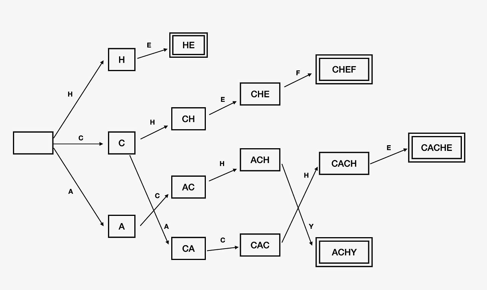
    
2. 각 노드에 대해 fail함수를 작성한다
    
    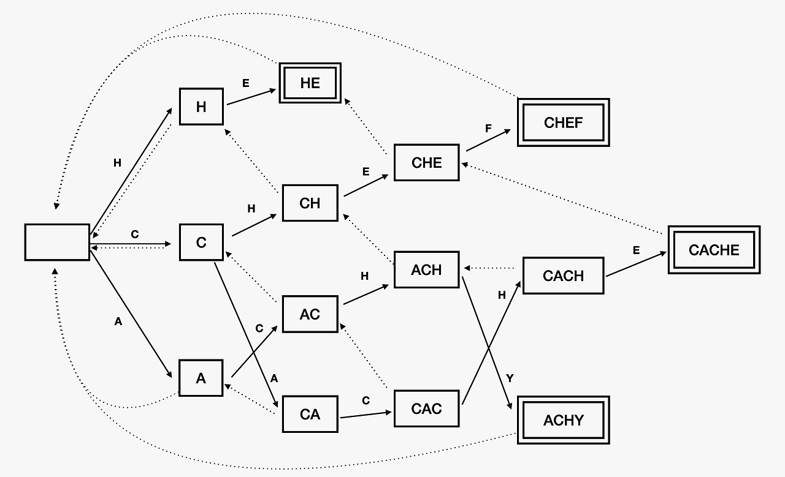
    
    - 계산 방법
        1. bfs로 depth가 낮은것부터 천천히 계산한다.
        
        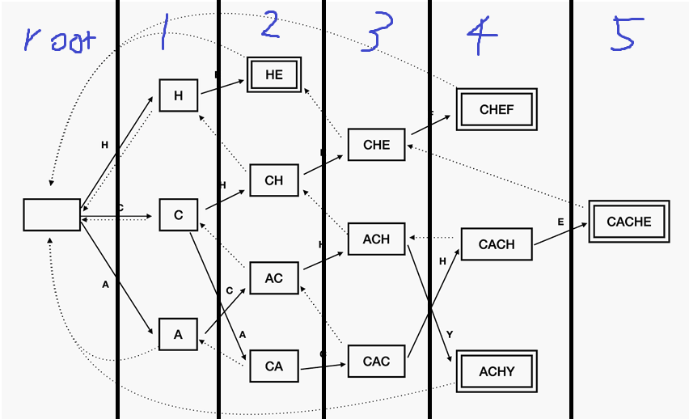
        
        1. 무조건 depth-1 은 root 노드로 fail을 이어준다.
        
        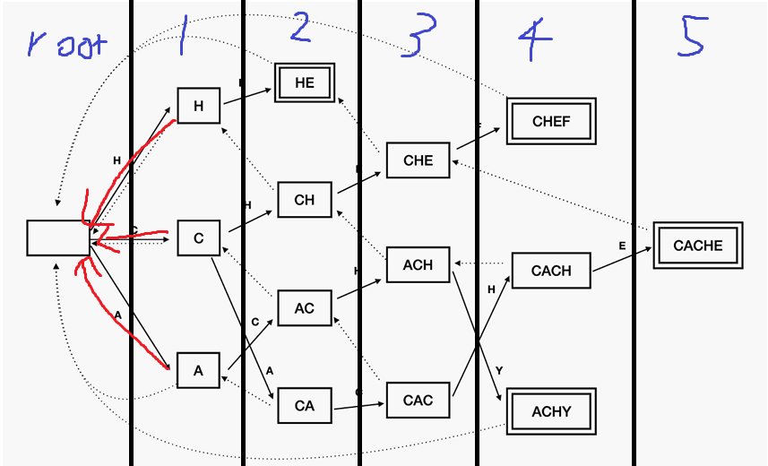
        
        1. 그 이후 노드들은 이러한 계산을 거치게 된다.
        
        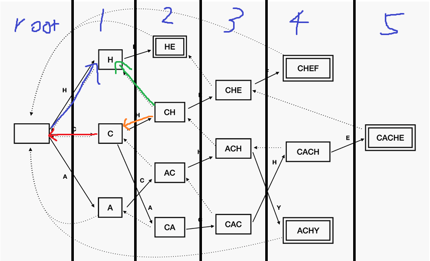
        
        1. 첫번째는 우선적으로 무조건 부모노드로 간다 ( 주황선)
        2. 부모 노드에서 자기가 만들어질때 쓰인 char 경로가 있는지 확인한다. (C  -H→ CH, 임으로 여기선 H)
            1. if success → 그 노드로 이동(파란선)하고 그 노드가 fail 경로가 됨 ( 초록선)
            2. else → 부모 노드로 이동 (빨간선)
        3. 만약 root 노드에 도착했는데도 연결되지 않았다면 root 노드가 fail 경로
        4. 다른 예시)
            
            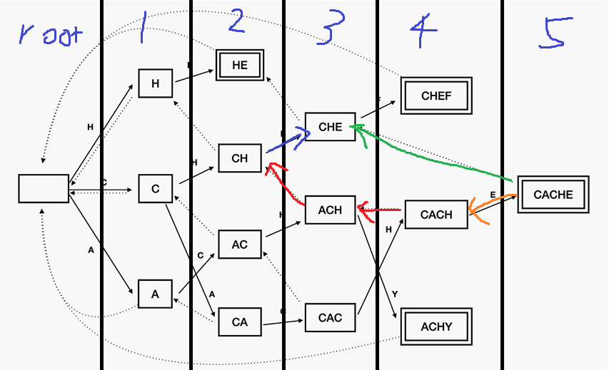
            
3. kmp처럼 이 fail함수를 통해 매칭을 시작한다
    - 매칭 방법
        
        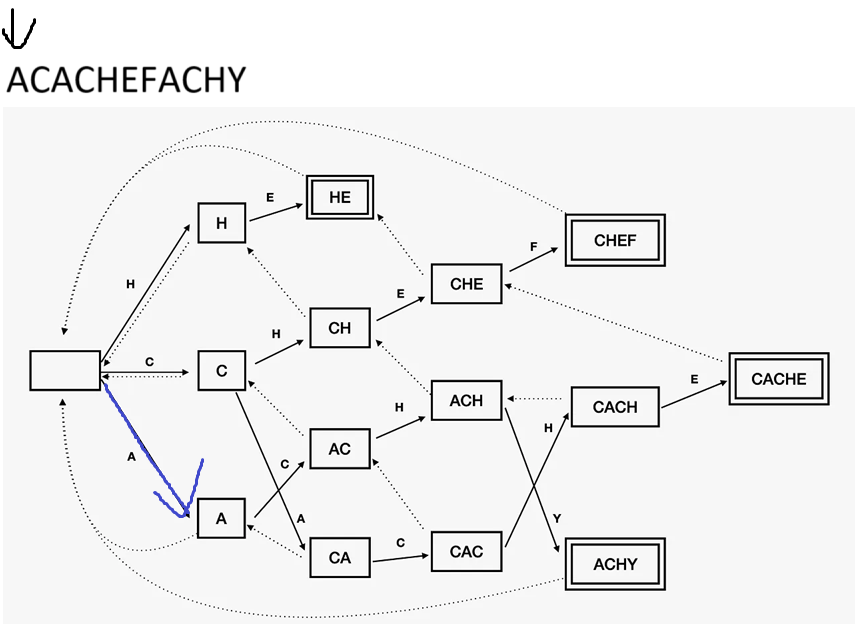
        
        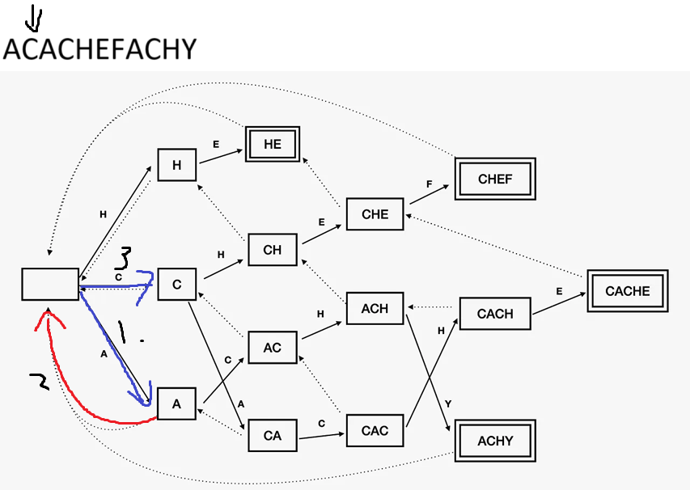
        
        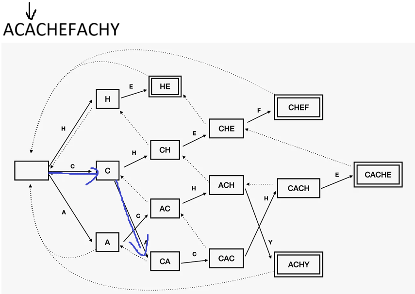
        
        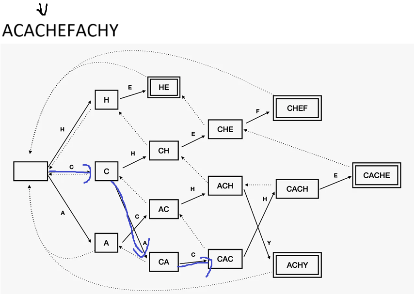
        
        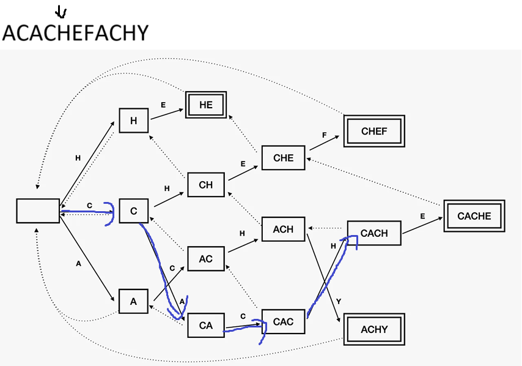
        
        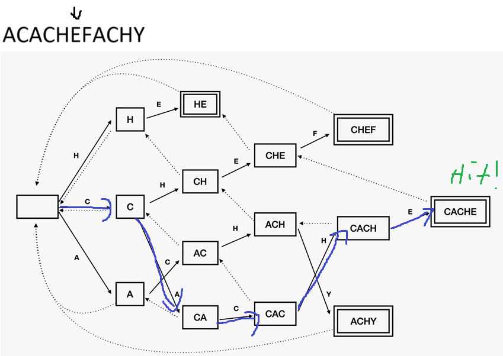
        
        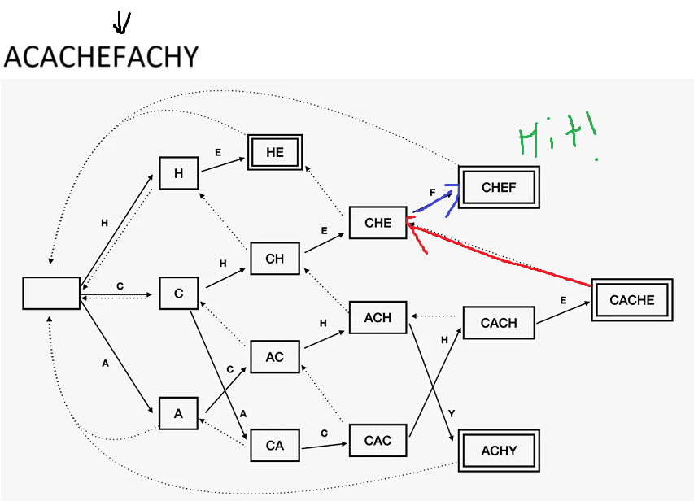
        
        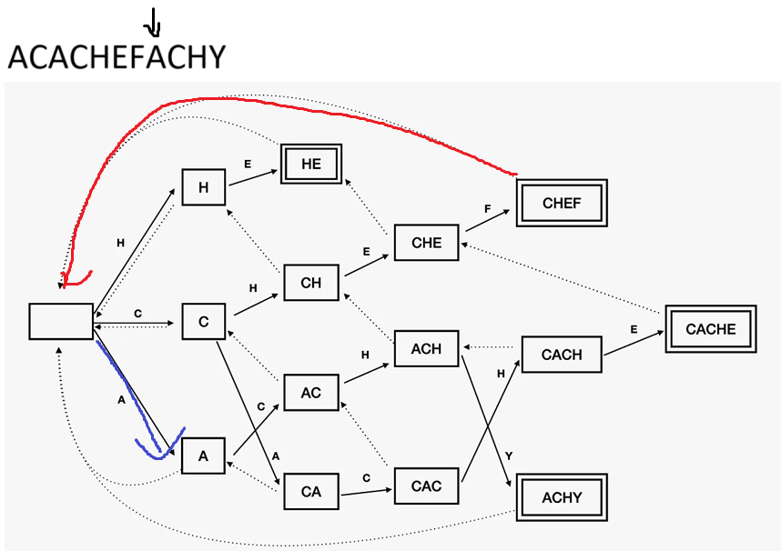
        
        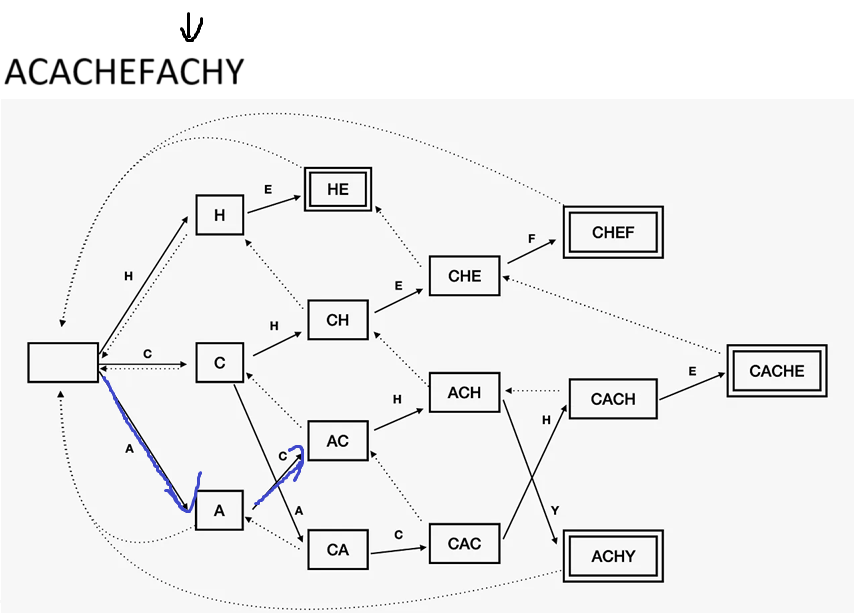
        
        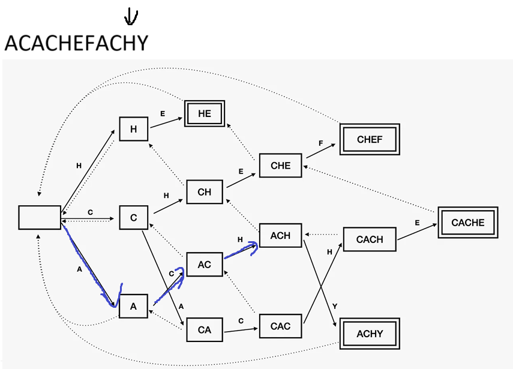
        
        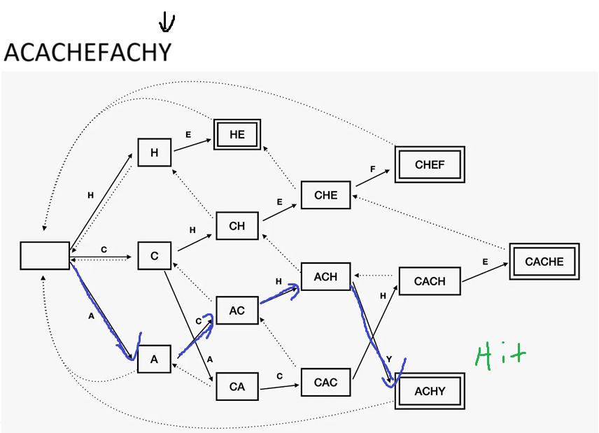
        
        ### 결과)
        
        CACHE, CHEF, ACHY를 찾았다
        

## 구현

```python
from collections import deque, defaultdict

class AhoCorasick:
    class Node:
        def __init__(self):
            self.children = dict()
            self.fail = None
            self.output = []

    def __init__(self):
        self.root = self.Node()

    def insert(self, word):
        node = self.root
        for char in word:
            if char not in node.children:
                node.children[char] = self.Node()
            node = node.children[char]
        node.output.append(word)  # 패턴 끝에 도달하면 출력 리스트에 추가

    def build(self):
        queue = deque()

        # 1. 루트의 모든 자식은 실패 링크가 루트
        for char, child in self.root.children.items():
            child.fail = self.root
            queue.append(child)

        # 2. BFS로 실패 링크 연결
        while queue:
            current = queue.popleft()
            for char, child in current.children.items():
                # 부모 노드의 실패 링크를 따라가며 가능한 문자를 찾음
                fail_node = current.fail
                while fail_node and char not in fail_node.children:
                    fail_node = fail_node.fail
                child.fail = fail_node.children[char] if fail_node and char in fail_node.children else self.root

                # 실패 링크가 가리키는 노드의 출력 결과도 같이 물려줌
                child.output += child.fail.output

                queue.append(child)

    def search(self, text):
        node = self.root
        results = defaultdict(list)  # 패턴별로 등장 위치 저장

        for i, char in enumerate(text):
            # 실패 링크를 따라가며 문자 전이를 찾음
            while node and char not in node.children:
                node = node.fail
            node = node.children[char] if node and char in node.children else self.root

            for pattern in node.output:
                results[pattern].append(i - len(pattern) + 1)  # 패턴의 시작 위치 기록

        return dict(results)

```
