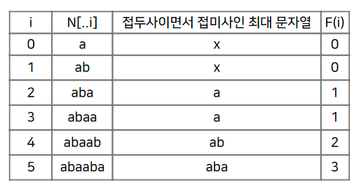

[상위 페이지 · String](/study/algorithms/string/)

KMP(Knuth-Morris-Pratt) 알고리즘은 문자열 검색을 위한 효율적인 알고리즘이다.

이 알고리즘은 1977년 Donald Knuth와 Vaughan Pratt, 그리고 독립적으로 James H. Morris가 함께 개발한 것이다.

## 기본 개념

KMP 알고리즘은 문자열 매칭 과정에서 불필요한 비교를 줄이기 위해 패턴의 접두사와 접미사 정보를 활용하는 알고리즘이다.

## 특징

- 시간 복잡도가 O(N + M)으로, 단순 비교 방식의 O(NM)보다 효율적이다.
- 패턴의 접두사와 접미사 정보를 저장하는 실패 함수(failure function)를 사용한다.
- 문자열 매칭 실패 시 처음부터 다시 비교하지 않고, 이전 비교 결과를 활용한다.

## 동작 설명



먼저 패턴을 위와 같이 전처리 한다.

KMP 알고리즘의 패턴 전처리는 접두사와 접미사의 일치 정보를 저장하는 과정이다.

전처리 과정의 핵심 단계는 다음과 같다:

1. 실패 함수(failure function) 또는 부분 일치 테이블(partial match table)을 생성한다.
2. 각 위치에서 접두사와 접미사가 일치하는 최대 길이를 계산한다.
3. 계산된 값을 배열에 저장하여 문자열 매칭 시 활용한다.

예를 들어, 패턴 "abaaba"의 전처리 결과는 [0,0,1,1,2,3]이 된다.

이는 각 위치에서:

- a: 이전 일치하는 접두사-접미사 없음 (0)
- b: 이전 일치하는 접두사-접미사 없음 (0)
- a: "a"가 일치 (1)
- a: "a"가 일치 (1)
- b: "ab"가 일치 (2)
- a: "aba"가 일치 (3)

이렇게 생성된 전처리 정보는 문자열 매칭 과정에서 불일치가 발생했을 때, 다음 비교 위치를 효율적으로 결정하는데 사용된다.

## 이 전처리를 이용하여 똑똑하게 점프하기


마지막 6번을 보면 알듯 a에서 미스매치가 나고 p[5] = 3에 따라 3번 인덱스로 갔지만 여전히 미스매치여서 p[3] = 1에 따라 1번 인덱스까지는 가는걸 볼 수 있다.

## 구현

```python
def get_pi(pattern):
    n = len(pattern)
    pi = [0] * n
    j = 0  # 접두사의 길이

    for i in range(1, n):
        while j > 0 and pattern[i] != pattern[j]:
            j = pi[j - 1]
        if pattern[i] == pattern[j]:
            j += 1
            pi[i] = j
    return pi

def kmp_search(text, pattern):
    pi = get_pi(pattern)
    n, m = len(text), len(pattern)
    j = 0  # 패턴 인덱스
    result = []

    for i in range(n):  # 텍스트 인덱스
        while j > 0 and text[i] != pattern[j]:
            j = pi[j - 1]
        if text[i] == pattern[j]:
            j += 1
            if j == m:
                result.append(i - m + 1)  # 패턴이 끝까지 일치한 경우
                j = pi[j - 1]  # 다음 일치를 위해 점프
    return result

```
