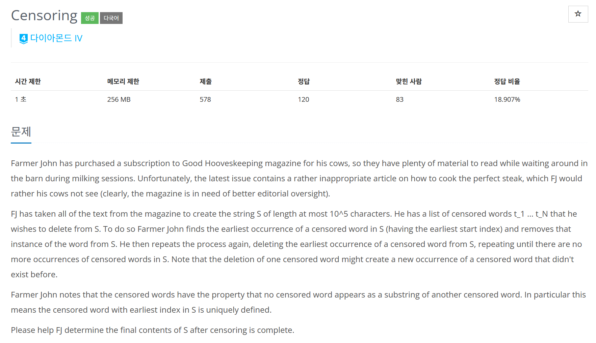
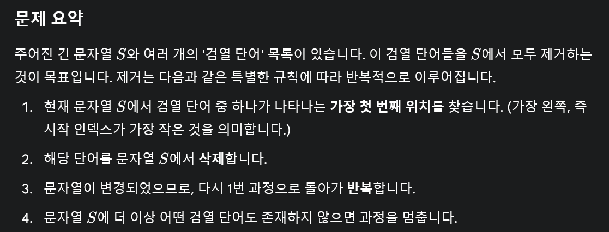

[상위 페이지 · 다이아](/study/algorithms/string/diamond/)



## 문제 해석



## 문제 태그

- DP
- 자료구조
- 문자열
- 트리
- 스택
- 트라이
- 아호 코라식

## 아이디어

- 아호 코라식에 검열단어를 전부 집어넣기
- 스택을 통해 최종 문자열을 관리
- 한글자 추가될 때마다 아호코라식을 통해 방금 추가된 부분까지 검열단어가 포함되는지 확인 후 그 길이만큼 pop

## 정답

```python
from collections import deque
import sys

class Node:
    def __init__(self):
        self.children = [None] * 26
        self.fail = None
        self.output = []

class AhoCorasick:
    def __init__(self):
        self.root = Node()
        self.root.fail = self.root
        self.pattern_lengths = {}

    def add_pattern(self, pattern, id):
        node = self.root
        for char in pattern:
            idx = ord(char) - ord('a')
            if self.root.children[idx] is None:  # 클래스 초기화에서 None으로 설정
                pass
            if node.children[idx] is None:
                node.children[idx] = Node()
            node = node.children[idx]
        node.output.append(id)
        self.pattern_lengths[id] = len(pattern)

    def build_fail(self):
        queue = deque()
        for i in range(26):
            if self.root.children[i]:
                self.root.children[i].fail = self.root
                queue.append(self.root.children[i])
        while queue:
            current = queue.popleft()
            for i in range(26):
                if current.children[i]:
                    child = current.children[i]
                    fail = current.fail
                    while fail != self.root and fail.children[i] is None:
                        fail = fail.fail
                    if fail.children[i]:
                        fail = fail.children[i]
                    child.fail = fail if (fail != self.root or self.root.children[i]) else self.root
                    child.output = child.output + child.fail.output
                    queue.append(child)

    def build_transitions(self):
        queue = deque()
        for i in range(26):
            if self.root.children[i]:
                queue.append(self.root.children[i])
            else:
                self.root.children[i] = self.root
        while queue:
            current = queue.popleft()
            for i in range(26):
                if current.children[i]:
                    queue.append(current.children[i])
                else:
                    current.children[i] = current.fail.children[i]

input = sys.stdin.readline
S = input().strip()
N = int(input().strip())
patterns = [input().strip() for _ in range(N)]
ac = AhoCorasick()
for i, p in enumerate(patterns):
    ac.add_pattern(p, i)
ac.build_fail()
ac.build_transitions()
result = []
state_history = [ac.root]
for char in S:
    current = state_history[-1]
    idx = ord(char) - ord('a')
    node = current.children[idx]
    result.append(char)
    state_history.append(node)
    if node.output:
        idx = node.output[0]
        pat_len = ac.pattern_lengths[idx]
        for _ in range(pat_len):
            result.pop()
            state_history.pop()
print(''.join(result))
```
