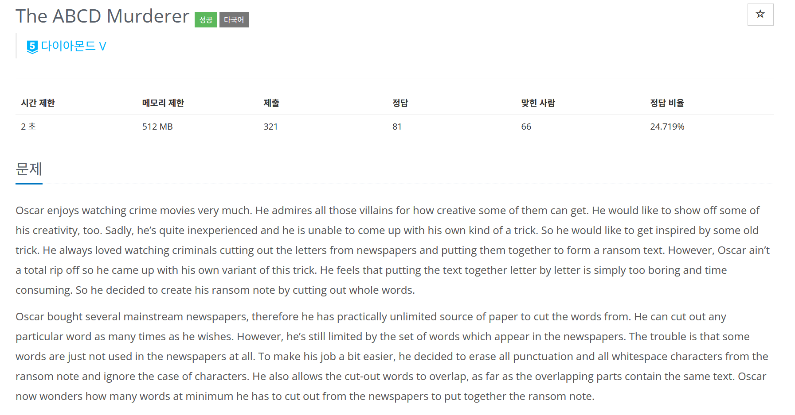
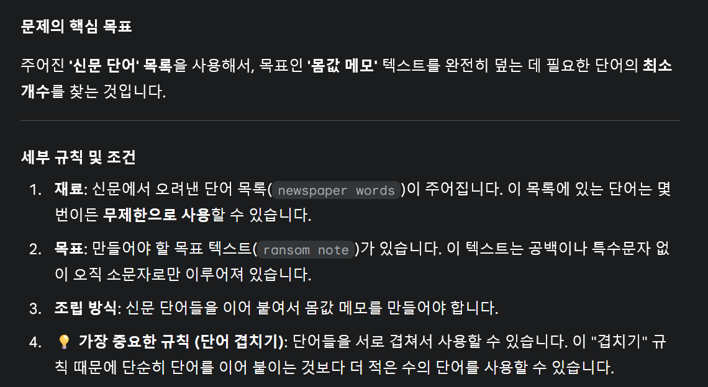

[상위 페이지 · 다이아](/study/algorithms/string/diamond/)



## 문제 해석



## 문제 태그

- DP
- 자료구조
- 그리디
- 문자열
- 트리
- 트라이
- 아호 코라식

## 아이디어

- 아호 코라식을 통해 몸값 메모를 처음부터 끝까지 순회하며 최대 도달 거리를 계산한다.
- 계산한 최대 도달 거리 테이블을 이용해서 문제를 다음과 같이 더 단순한 형태로 변형한다
    - s번 컨에 서 있다면 최대 s + max_reach[s] 번칸까지 점프 가능할때 최소 몇 번의 점프로 마지막까지 도달 할 수 있는가
- 그리디 알고리즘을 사용하여 다음을 반복한다
    - 내가 이전에 덮은 영역 내에서 시작할 수 있는 점프 중 가장 멀리까지 도달하게 해주는 점프를 선택

## 정답

```python
import sys
from collections import deque

input = sys.stdin.readline

class Node:
    def __init__(self):
        self.children = {}
        self.fail = None
        self.output = []

class AhoCorasick:
    def __init__(self):
        self.root = Node()
        self.root.fail = self.root
        self.pattern_lengths = {}

    def add_pattern(self, pattern, id):
        node = self.root
        for char in pattern:
            if char not in node.children:
                node.children[char] = Node()
            node = node.children[char]
        node.output.append(id)
        self.pattern_lengths[id] = len(pattern)

    def build_fail(self):
        queue = deque()
        for child in self.root.children.values():
            child.fail = self.root
            queue.append(child)

        while queue:
            current = queue.popleft()
            for char, child in current.children.items():
                fail = current.fail
                while fail != self.root and char not in fail.children:
                    fail = fail.fail
                if char in fail.children:
                    fail = fail.children[char]
                else:
                    fail = self.root

                child.fail = fail
                child.output = child.output + child.fail.output

                queue.append(child)

def solve():
    L = int(input().strip())
    ransom_note = input().strip()
    N = len(ransom_note)

    ac = AhoCorasick()
    for i in range(L):
        pattern = input().strip()
        ac.add_pattern(pattern, i)

    ac.build_fail()

    max_reach = [0] * N
    node = ac.root
    for i in range(N):
        char = ransom_note[i]
        while node != ac.root and char not in node.children:
            node = node.fail
        if char in node.children:
            node = node.children[char]
        else:
            node = ac.root

        for pat_id in node.output:
            length = ac.pattern_lengths[pat_id]
            start = i - length + 1
            if start >= 0:
                max_reach[start] = max(max_reach[start], length)

    intervals = [(s, s + max_reach[s]) for s in range(N) if max_reach[s] > 0]
    intervals.sort(key=lambda x: x[0])

    if not intervals:
        print(-1)
        return

    current = 0
    count = 0
    idx = 0
    max_end = 0
    num_intervals = len(intervals)

    while current < N:
        while idx < num_intervals and intervals[idx][0] <= current:
            max_end = max(max_end, intervals[idx][1])
            idx += 1

        if max_end <= current:
            print(-1)
            return

        count += 1
        current = max_end

    print(count)

if __name__ == "__main__":
    solve()
```
