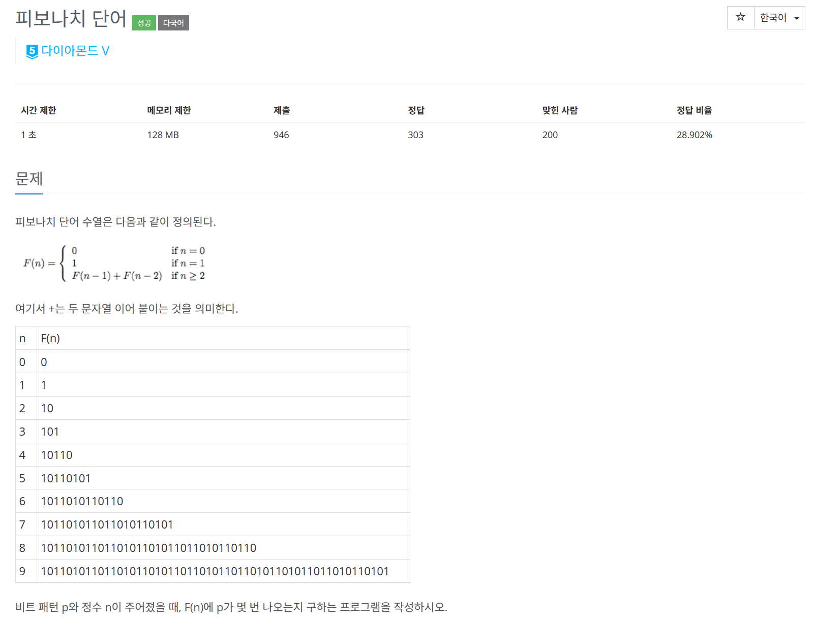

[상위 페이지 · String](/study/algorithms/string/)



## 문제 태그

- DP
- 문자열
- KMP

## 아이디어

- 원래는 KMP로 풀어야하지만 아호 코라식이랑 시간복잡도 차이가 나지 않아 구현되어있던 아호코라식을 사용함
- 아호코라식에 단일 패턴 p만 삽입하고 fail 함수 구축
- 전이 테이블과 개수테이블 구축
    - 전이테이블 : 상태 s에서 문자 c를 읽을때의 다음 ID
    - 개수테이블: 그 전이에서 발생하는 매치 수
- dp 시작
    - 두개의 dp 테이블이 필요함
        - 상태 : 상태 s에서 F(k)를 읽은 후 도착하는 끝 상태
        - 개수 테이블 : 상태 s에서 시작해서 F(k)를 읽을 때 발생하는 총 매치 수

## 정답

```python
import sys
from collections import deque

class Node:
    def __init__(self):
        self.children = {}
        self.fail = None
        self.output = []

class AhoCorasick:
    def __init__(self):
        self.root = Node()
        self.root.fail = self.root
        self.pattern_lengths = {}

    def add_pattern(self, pattern, id):
        node = self.root
        for char in pattern:
            if char not in node.children:
                node.children[char] = Node()
            node = node.children[char]
        node.output.append(id)
        self.pattern_lengths[id] = len(pattern)

    def build_fail(self):
        queue = deque()
        for child in self.root.children.values():
            child.fail = self.root
            queue.append(child)
        while queue:
            current = queue.popleft()
            for char, child in current.children.items():
                fail = current.fail
                while fail != self.root and char not in fail.children:
                    fail = fail.fail
                if char in fail.children:
                    fail = fail.children[char]
                child.fail = fail if fail != self.root or char in self.root.children else self.root
                child.output = child.output + child.fail.output
                queue.append(child)

input = sys.stdin.readline

case = 1
while True:
    try:
        n = int(input().strip())
        p = input().strip()
    except:
        break
    if not p:
        continue

    ac = AhoCorasick()
    ac.add_pattern(p, 0)
    ac.build_fail()

    nodes = []
    node_to_id = {}
    queue = deque([ac.root])
    node_to_id[ac.root] = 0
    nodes.append(ac.root)
    while queue:
        cur = queue.popleft()
        for child in cur.children.values():
            if child not in node_to_id:
                id = len(nodes)
                node_to_id[child] = id
                nodes.append(child)
                queue.append(child)

    num_states = len(nodes)

    trans = [[0] * 2 for _ in range(num_states)]
    outcount = [[0] * 2 for _ in range(num_states)]

    for i in range(num_states):
        node = nodes[i]
        for c_idx, char in enumerate(['0', '1']):
            if char in node.children:
                next_node = node.children[char]
            else:
                if node == ac.root:
                    next_node = ac.root
                else:
                    fail_id = node_to_id[node.fail]
                    next_id = trans[fail_id][c_idx]
                    next_node = nodes[next_id]
            next_id = node_to_id[next_node]
            trans[i][c_idx] = next_id
            outcount[i][c_idx] = len(next_node.output)

    dp_count = [[0] * num_states for _ in range(n + 1)]
    dp_end = [[0] * num_states for _ in range(n + 1)]

    for s in range(num_states):
        c_idx = 0
        dp_count[0][s] = outcount[s][c_idx]
        dp_end[0][s] = trans[s][c_idx]

    if n >= 1:
        for s in range(num_states):
            c_idx = 1
            dp_count[1][s] = outcount[s][c_idx]
            dp_end[1][s] = trans[s][c_idx]

    for k in range(2, n + 1):
        for s in range(num_states):
            mid = dp_end[k - 1][s]
            count1 = dp_count[k - 1][s]
            count2 = dp_count[k - 2][mid]
            end = dp_end[k - 2][mid]
            dp_count[k][s] = count1 + count2
            dp_end[k][s] = end

    ans = dp_count[n][0]
    print(f"Case {case}: {ans}")
    case += 1
```
