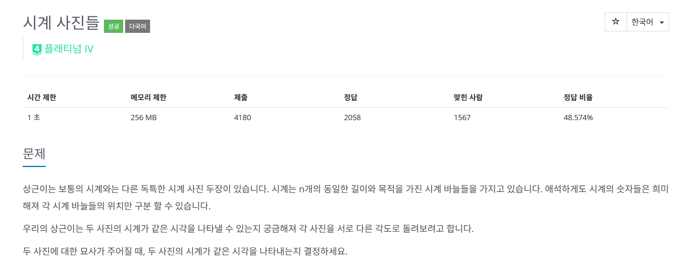

[상위 페이지 · 플레티넘](/study/algorithms/string/platinum/)



## 문제 태그

- 문자열
- KMP

## 아이디어

1. GPT한테 문제 이해시켜달라고 했더니 코드를 줘버림. 문제도 이해 안되는거 날먹하기로 결정

## 정답

```python
import sys
input = sys.stdin.readline

def build_lps(pat):
    """KMP용 LPS(π) 테이블 생성"""
    n = len(pat)
    lps = [0]*n
    j = 0
    for i in range(1, n):
        while j and pat[i] != pat[j]:
            j = lps[j-1]
        if pat[i] == pat[j]:
            j += 1
            lps[i] = j
    return lps

def kmp_search(txt, pat):
    """pat이 txt 안에 부분 문자열로 들어있는지 검사"""
    lps = build_lps(pat)
    j = 0
    for x in txt:
        while j and x != pat[j]:
            j = lps[j-1]
        if x == pat[j]:
            j += 1
            if j == len(pat):
                return True
    return False

def solve_case():
    n = int(input())
    A = sorted(int(x) for x in input().split())
    B = sorted(int(x) for x in input().split())
    # 인접 바늘 간 차이(n개)
    dA = [ (A[(i+1)%n] - A[i]) % 360000 for i in range(n) ]
    dB = [ (B[(i+1)%n] - B[i]) % 360000 for i in range(n) ]
    # dA를 두 번 이어 붙여서 순환 검사용
    dA2 = dA + dA
    # KMP 검색
    if kmp_search(dA2, dB):
        print("possible")
    else:
        print("impossible")

def main():
    solve_case()

if __name__ == "__main__":
    main()

```
