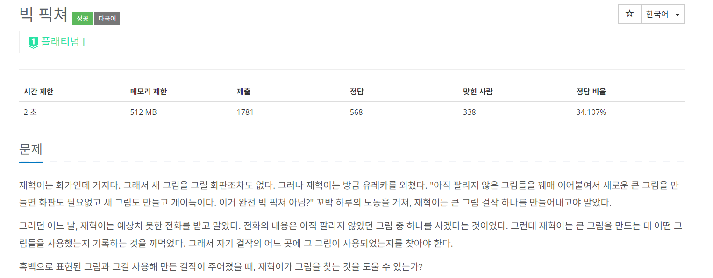

[상위 페이지 · 플레티넘](/study/algorithms/string/platinum/)



## 제목 태그

- 문자열
- 트라이
- 아호 코라식

## 아이디어

1. **행 단위 패턴화**
    
    작은 그림의 각 행(길이 wp)을 하나의 문자열 패턴으로 보고, 이를 모두 아호-코라식(AC) 트리에 넣는다. 이렇게 하면 2차원 문제를 “가로 매칭”과 “세로 누적” 두 단계로 분리할 수 있다.
    
2. **AC 트리 구현 최적화**
    - 알파벳이 ‘x’, ‘o’ 두 개뿐이므로 children=[None, None] 고정 배열로 딕셔너리를 대체한다.
    - 빌드 단계에서 ‘goto + fail’ 압축을 적용해, 없는 간선을 실패 링크를 따라 미리 채워 둔다. 검색 중에는 while루프 없이 한 번의 인덱스 접근으로 상태 전이가 끝난다.
3. **가로 스캔**
    
    큰 그림의 각 행을 왼쪽에서 오른쪽으로 읽으며 AC 전이를 수행한다. 열 인덱스 c가 wp-1 이상일 때, 현재 노드의 output 비트마스크가 “이 열 구간에서 어떤 패턴 행들이 맞았는지”를 알려 준다.
    
4. **세로 누적**
    
    열별로 state[s]를 유지한다.
    
    ```
    state[s] = ((state[s] << 1) | 1) & output_mask
    ```
    
    - 이렇게 하면 비트 k가 켜져 있을 때 “패턴의 0~k행이 연속으로 맞았다”는 뜻이다. 집합이나 반복문 없이 한 줄의 비트 연산으로 세로 누적이 끝난다.
5. **완전 매칭 판정**
    
    state[s]의 최상위 비트(값 1 << (hp-1))가 1이면, 작은 그림의 모든 hp행이 연속으로 맞은 것이므로 (현재행 − hp + 1, s) 위치에 매칭 하나를 추가한다.
    
6. **복잡도**
    - 트리 구축: O(hp × wp)
    - 전체 스캔: O(hm × wm) – 입력 격자의 모든 칸을 정확히 한 번씩만 읽는다.

## 정답

```python
import sys
from collections import deque

hp, wp, hm, wm = map(int, sys.stdin.readline().split())
pic   = [sys.stdin.readline().strip() for _ in range(hp)]
board = [sys.stdin.readline().strip() for _ in range(hm)]

conv  = {'x': 0, 'o': 1}
ncol  = wm - wp + 1
MASK  = (1 << hp) - 1
FULL  = 1 << (hp - 1)          # hp번째 비트

class Node:
    def __init__(self):
        self.child = [None, None]
        self.fail  = None
        self.out   = 0

root = Node()

def insert(row, idx):
    node = root
    for ch in row:
        k = conv[ch]
        if node.child[k] is None:
            node.child[k] = Node()
        node = node.child[k]
    node.out |= 1 << idx

for i, row in enumerate(pic):
    insert(row, i)

def build():
    q = deque()
    root.fail = root
    for k in range(2):
        if root.child[k]:
            root.child[k].fail = root
            q.append(root.child[k])
        else:
            root.child[k] = root
    while q:
        v = q.popleft()
        for k in range(2):
            u = v.child[k]
            if u:
                u.fail = v.fail.child[k]
                u.out |= u.fail.out
                q.append(u)
            else:
                v.child[k] = v.fail.child[k]

build()

state = [0] * ncol
ans   = 0

for r in range(hm):
    node = root
    for c in range(wm):
        node = node.child[conv[board[r][c]]]
        if c >= wp - 1:
            s = c - wp + 1
            state[s] = (((state[s] << 1) | 1) & node.out) & MASK
            if state[s] & FULL:
                ans += 1

print(ans)

```
