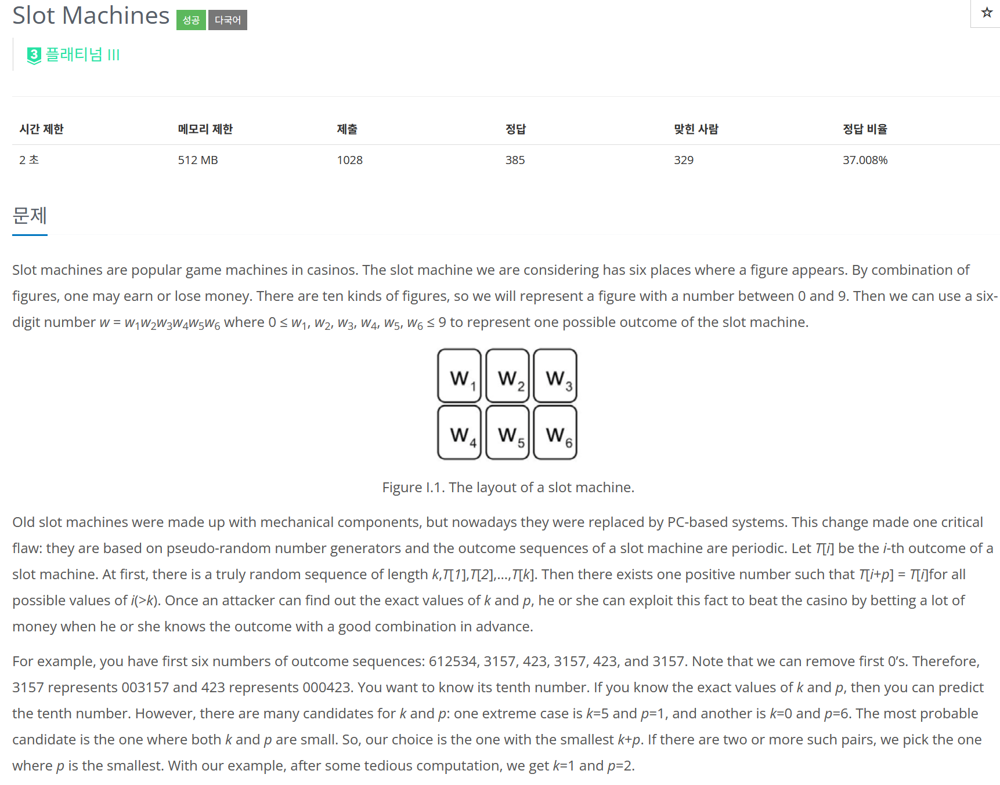

[상위 페이지 · String](/study/algorithms/string/)



## 문제 해석

- n개의 숫자가 주어지고 k개의 랜덤한 숫자 뒤에 주기 p의 숫자가 주어진다. 이때 k,p 쌍을 최소로 구해라

## 문제 태그

- 문자열
- KMP

## 아이디어

1. kmp를 이용하여 주어진 수열을 뒤집고 수열 패턴을 기록하면서 후에 같은 수열이 나오는지 패턴을 매치한다
2. 만약 매치가 여러번 된다면 (길이 - 패턴 길이[i])로 최소인 i를 구한다

## 정답

```python
import sys

input = sys.stdin.readline
n = int(input())
T = list(map(int, input().split()))

R = T[::-1]

kmp = [0] * n
j = 0
for i in range(1, n):
    while j > 0 and R[i] != R[j]:
        j = kmp[j - 1]
    if R[i] == R[j]:
        j += 1
    kmp[i] = j

max_pi = -1
best_i = 0
for i, v in enumerate(kmp):
    if v > max_pi:
        max_pi = v
        best_i = i

L = best_i + 1
p = L - max_pi
k = n - L

print(k, p)

```
