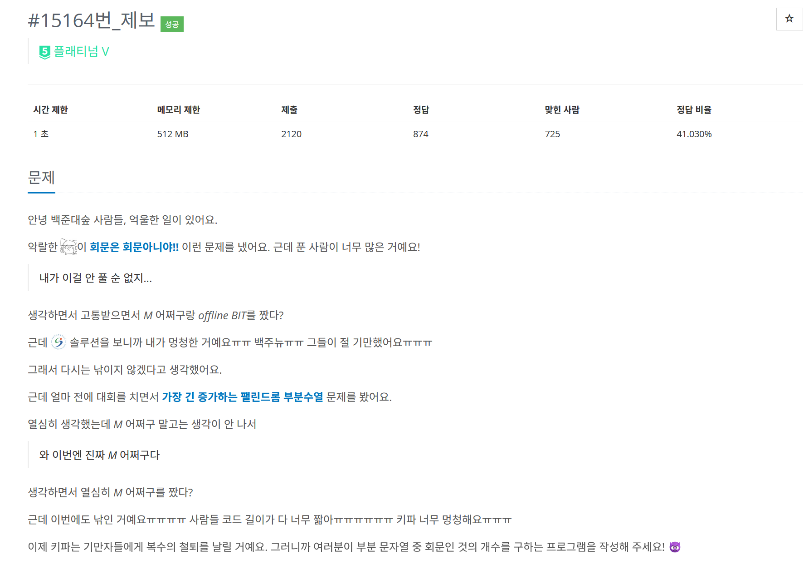

[상위 페이지 · 플레티넘](/study/algorithms/string/platinum/)



## 문제 태그

- 매내처

## 아이디어

1. 매내처를 사용해서 회문의 개수를 구한다
2. 매내처 특성상 회문이 하나 증가할때마다 반지름이 +2 됨으로 매내처로 구해진 배열 합산을 하되 //2를 해야한다

## 정답

```python
import sys
input = sys.stdin.readline

def count_palindromes(s):
    T = ['^']
    for ch in s:
        T += ['#', ch]
    T += ['#', '$']
    N = len(T)
    P = [0] * N
    center = right = 0
    for i in range(1, N - 1):
        mirror = 2*center - i
        if i < right:
            P[i] = min(right - i, P[mirror])
        while T[i + (1 + P[i])] == T[i - (1 + P[i])]:
            P[i] += 1
        if i + P[i] > right:
            center, right = i, i + P[i]
    return sum(p // 2 for p in P)

s = input().rstrip()
print(count_palindromes(s) + len(s))

```
