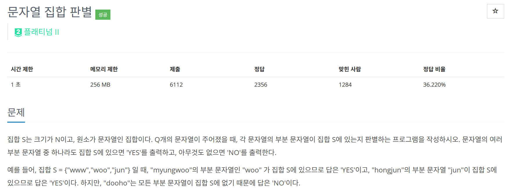

[상위 페이지 · 플레티넘](/study/algorithms/string/platinum/)



## 문제 태그

- 자료구조
- 문자열
- 트리
- 트라이
- 아호-코라식

## 아이디어

- 아호-코라식 알고리즘을 변형할 필요 없이 그대로 구현하면 된다.

## 정답

```python
from collections import deque

class Node:
    def __init__(self):
        self.children = {}  # 자식 노드: {char: Node}
        self.fail = None  # Fail 포인터
        self.output = []  # 이 노드에서 끝나는 패턴 인덱스 리스트

class AhoCorasick:
    def __init__(self):
        self.root = Node()
        self.root.fail = self.root  # 루트의 Fail은 자기 자신
        self.pattern_lengths = {}  # 패턴 인덱스: 길이 저장 dict 추가

    def add_pattern(self, pattern, id):
        # 패턴을 Trie에 삽입
        node = self.root
        for char in pattern:
            if char not in node.children:
                node.children[char] = Node()
            node = node.children[char]
        node.output.append(id)  # 패턴 끝에 인덱스 추가
        self.pattern_lengths[id] = len(pattern)  # 패턴 길이 저장

    def build_fail(self):
        # BFS로 Fail 포인터 구축
        queue = deque()
        for child in self.root.children.values():
            child.fail = self.root
            queue.append(child)

        while queue:
            current = queue.popleft()
            for char, child in current.children.items():
                fail = current.fail
                while fail != self.root and char not in fail.children:
                    fail = fail.fail
                if char in fail.children:
                    fail = fail.children[char]
                child.fail = fail if fail != self.root or char in self.root.children else self.root

                # 출력 링크: Fail의 output을 병합 (리스트 병합)
                child.output = child.output + child.fail.output

                queue.append(child)

    def search(self, text):
        # 텍스트에서 패턴 검색, 매칭 위치 반환
        node = self.root
        results = []  # (패턴 인덱스, 시작 위치) 리스트
        for i, char in enumerate(text):
            while node != self.root and char not in node.children:
                node = node.fail
            if char in node.children:
                node = node.children[char]
            else:
                node = self.root  # 루트로 리셋

            for idx in node.output:
                start_pos = i - self.pattern_lengths[idx] + 1
                results.append((idx, start_pos))
        return results

ac = AhoCorasick()
N = int(input())
for i in range(N):
    text = input()
    ac.add_pattern(text, i)

ac.build_fail()

Q = int(input())
for _ in range(Q):
    text = input()
    print("YES" if ac.search(text) else "NO")

```
