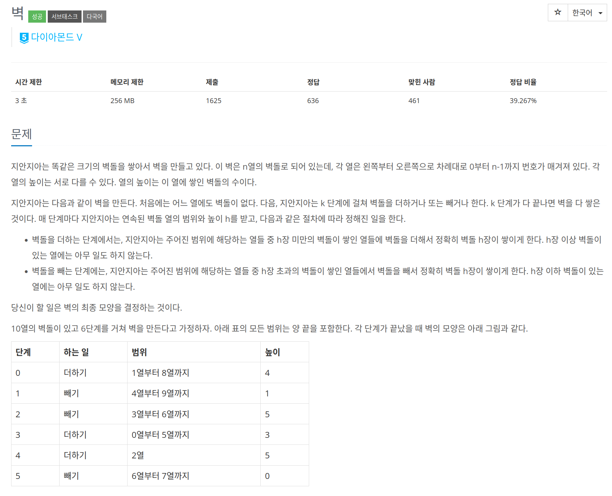
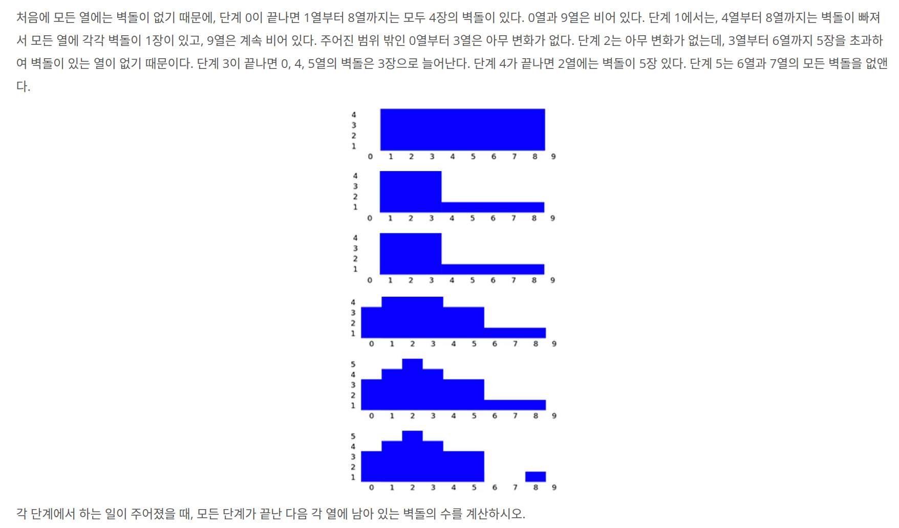

[상위 페이지 · 알고리즘](/study/algorithms/)





## 문제 태그

- 자료 구조
- 세그먼트 트리
- 느리게 갱신되는 세그먼트 트리

## 아이디어

- 처음에는 모든 높이가 0이다. 벽돌을 더하는 쿼리는 구간의 각 높이에 max(현재 높이, h), 빼는 쿼리는 min(현재 높이, h)를 적용하는 것으로 보면 된다.
- 노드에 최댓값과 두 번째 최댓값을 저장한다. 두 번째 최댓값 < h < 최댓값이면 최댓값인 열만 낮아진다. 그 열의 개수를 알고 있으므로 노드의 합과 최댓값을 한 번에 갱신할 수 있다. 하한을 적용할 때는 최솟값과 두 번째 최솟값으로 같은 판정을 한다.
- h가 두 번째 극값까지 건드리는 경우 자식으로 내려간다. 한 노드에서 끝냈다면 상한과 하한을 저장했다가 다음에 내려갈 때 반영한다. 마지막에는 리프까지 내려가서 열별 높이를 뽑는다.

예를 들어 높이가 2, 5, 5인 구간을 4로 자르면 5인 두 열만 바뀐다. 2 이하로 자르는 쿼리는 다른 높이까지 영향을 받을 수 있으므로 자식을 확인한다. 입력의 열 번호는 0부터 시작하고 코드의 트리는 1부터 시작한다.

[백준 문제](https://www.acmicpc.net/problem/10070) · [Algorithm 저장소 코드](https://github.com/Creeper0809/Algorithm/blob/e607692decddf5cee6a9ade117d588eb6e7e376b/Solve/%EC%9E%90%EB%A3%8C%EA%B5%AC%EC%A1%B0/10070.py)

## 정답

```python
import sys

input = sys.stdin.readline
sys.setrecursionlimit(200005)

class SegmentTreeBeats:
    def __init__(self, n, initial_value):
        self.n = n
        self.INF = float('inf')
        self.tree = [self.Node() for _ in range(4 * n)]
        a = [0] + [initial_value] * n
        self.build(1, 1, n, a)

    class Node:
        def __init__(self):
            self.sum = 0
            self.max1 = -float('inf')
            self.max2 = -float('inf')
            self.count_max1 = 0
            self.min1 = float('inf')
            self.min2 = float('inf')
            self.count_min1 = 0
            self.lazy_min = float('inf')
            self.lazy_max = -float('inf')

    def pushup(self, p):
        l, r = self.tree[2 * p], self.tree[2 * p + 1]
        node = self.tree[p]
        node.sum = l.sum + r.sum

        if l.max1 > r.max1:
            node.max1 = l.max1
            node.count_max1 = l.count_max1
            node.max2 = max(l.max2, r.max1)
        elif l.max1 < r.max1:
            node.max1 = r.max1
            node.count_max1 = r.count_max1
            node.max2 = max(r.max2, l.max1)
        else:
            node.max1 = l.max1
            node.count_max1 = l.count_max1 + r.count_max1
            node.max2 = max(l.max2, r.max2)

        if l.min1 < r.min1:
            node.min1 = l.min1
            node.count_min1 = l.count_min1
            node.min2 = min(l.min2, r.min1)
        elif l.min1 > r.min1:
            node.min1 = r.min1
            node.count_min1 = r.count_min1
            node.min2 = min(r.min2, l.min1)
        else:
            node.min1 = l.min1
            node.count_min1 = l.count_min1 + r.count_min1
            node.min2 = min(l.min2, r.min2)

    def build(self, p, l, r, a):
        node = self.tree[p]
        if l == r:
            node.sum = a[l]
            node.max1 = a[l]
            node.count_max1 = 1
            node.min1 = a[l]
            node.count_min1 = 1
            return
        mid = (l + r) // 2
        self.build(2 * p, l, mid, a)
        self.build(2 * p + 1, mid + 1, r, a)
        self.pushup(p)

    def apply_chmin(self, p, val):
        node = self.tree[p]
        if val >= node.max1: return
        node.sum -= (node.max1 - val) * node.count_max1
        if node.min1 == node.max1: node.min1 = val
        if node.min2 == node.max1: node.min2 = val
        node.max1 = val
        node.lazy_min = min(node.lazy_min, val)
        node.lazy_max = min(node.lazy_max, val)

    def apply_chmax(self, p, val):
        node = self.tree[p]
        if val <= node.min1: return
        node.sum += (val - node.min1) * node.count_min1
        if node.max1 == node.min1: node.max1 = val
        if node.max2 == node.min1: node.max2 = val
        node.min1 = val
        node.lazy_max = max(node.lazy_max, val)
        node.lazy_min = max(node.lazy_min, val)

    def propagate(self, p):
        node = self.tree[p]
        if node.lazy_max != -self.INF:
            self.apply_chmax(2 * p, node.lazy_max)
            self.apply_chmax(2 * p + 1, node.lazy_max)
            node.lazy_max = -self.INF
        if node.lazy_min != self.INF:
            self.apply_chmin(2 * p, node.lazy_min)
            self.apply_chmin(2 * p + 1, node.lazy_min)
            node.lazy_min = self.INF

    def update_chmin(self, p, l, r, start, end, val):
        if start > r or end < l or self.tree[p].max1 <= val: return
        if start <= l and r <= end and self.tree[p].max2 < val:
            self.apply_chmin(p, val)
            return
        self.propagate(p)
        mid = (l + r) // 2
        self.update_chmin(2 * p, l, mid, start, end, val)
        self.update_chmin(2 * p + 1, mid + 1, r, start, end, val)
        self.pushup(p)

    def update_chmax(self, p, l, r, start, end, val):
        if start > r or end < l or self.tree[p].min1 >= val: return
        if start <= l and r <= end and self.tree[p].min2 > val:
            self.apply_chmax(p, val)
            return
        self.propagate(p)
        mid = (l + r) // 2
        self.update_chmax(2 * p, l, mid, start, end, val)
        self.update_chmax(2 * p + 1, mid + 1, r, start, end, val)
        self.pushup(p)

    def _get_final_array(self, p, l, r, result_array):
        if l == r:
            result_array[l - 1] = self.tree[p].sum
            return
        self.propagate(p)
        mid = (l + r) // 2
        self._get_final_array(2 * p, l, mid, result_array)
        self._get_final_array(2 * p + 1, mid + 1, r, result_array)

    def get_final_array(self):
        result = [0] * self.n
        self._get_final_array(1, 1, self.n, result)
        return result

n, k = map(int, input().split())

st = SegmentTreeBeats(n, 0)

for _ in range(k):
    op, left, right, height = map(int, input().split())
    if op == 1:
        st.update_chmax(1, 1, n, left + 1, right + 1, height)
    else:
        st.update_chmin(1, 1, n, left + 1, right + 1, height)

final_wall = st.get_final_array()

for height in final_wall:
    print(height)
```
