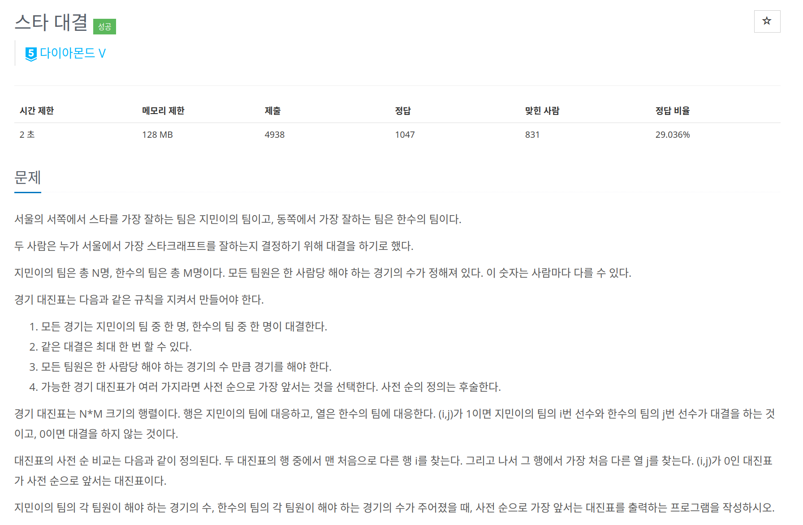

[상위 페이지 · 알고리즘](/study/algorithms/)



## 문제 태그

- 그래프 이론
- 최대 유량

## 아이디어

1. 서쪽 팀을 행, 동쪽 팀을 열로 두고 행에서 열로 용량 1인 간선을 연결한다. 소스에서 각 행까지의 용량은 그 선수의 경기 수, 각 열에서 싱크까지의 용량도 그 선수의 경기 수다. 행과 열의 합이 다르거나 최대 유량이 전체 경기 수보다 작으면 대진표를 만들 수 없다.
2. 가능한 대진표를 하나 만들었으면 왼쪽 위부터 칸을 하나씩 고정한다. 현재 칸이 1이라면 그 칸을 쓰지 않고 같은 행에서 같은 열로 갈 수 있는 잔여 경로를 찾는다. 이미 확정한 앞 행과 현재 행의 앞 열은 건드릴 수 없다.
3. 경로를 찾으면 그쪽으로 유량 1을 보내고 원래 칸의 유량 1을 취소한다. 이렇게 하면 각 행과 열의 합을 유지하면서 현재 칸을 0으로 바꿀 수 있다. 경로가 없으면 1을 고정한다.

2×2 대진표에서 행과 열의 합이 전부 1이라고 해 보자. 왼쪽 위가 1인 경우 두 경기를 반대 대각선으로 옮기면 첫 칸이 0이 된다. 앞 칸부터 가능한 한 0으로 정하므로 행 순서로 읽었을 때 가장 작은 대진표가 나온다.

[백준 문제](https://www.acmicpc.net/problem/1031) · [Algorithm 저장소 코드](https://github.com/Creeper0809/Algorithm/blob/e607692decddf5cee6a9ade117d588eb6e7e376b/Solve/%EA%B7%B8%EB%9E%98%ED%94%84/1031.py)

## 정답

```python
import sys
from collections import deque

input = sys.stdin.readline

class Dinic:
    def __init__(self, n):
        self.n = n
        self.graph = [{} for _ in range(n)]
        self.adj = [[] for _ in range(n)]
        self.level = [-1] * n
        self.iter = [0] * n

    def add_edge(self, fr, to, cap):
        if to not in self.graph[fr]:
            self.graph[fr][to] = 0
        self.graph[fr][to] = cap
        if fr not in self.graph[to]:
            self.graph[to][fr] = 0
        if to not in self.adj[fr]:
            self.adj[fr].append(to)
        if fr not in self.adj[to]:
            self.adj[to].append(fr)

    def bfs(self, s):
        self.level = [-1] * self.n
        self.level[s] = 0
        q = deque([s])
        while q:
            u = q.popleft()
            for v in self.adj[u]:
                if self.graph[u][v] > 0 and self.level[v] < 0:
                    self.level[v] = self.level[u] + 1
                    q.append(v)

    def dfs(self, u, t, f):
        if u == t:
            return f
        for i in range(self.iter[u], len(self.adj[u])):
            self.iter[u] = i
            v = self.adj[u][i]
            if self.level[u] < self.level[v] and self.graph[u][v] > 0:
                d = self.dfs(v, t, min(f, self.graph[u][v]))
                if d > 0:
                    self.graph[u][v] -= d
                    self.graph[v][u] += d
                    return d
        return 0

    def max_flow(self, s, t):
        flow = 0
        while True:
            self.bfs(s)
            if self.level[t] < 0:
                return flow
            self.iter = [0] * self.n
            f = self.dfs(s, t, sys.maxsize)
            while f > 0:
                flow += f
                f = self.dfs(s, t, sys.maxsize)

N, M = map(int, input().split())
row = list(map(int, input().split()))
column = list(map(int, input().split()))

if sum(row) != sum(column):
    print(-1)
    sys.exit()

K = N + M + 2
s = 0
t = K - 1
dinic = Dinic(K)

for i in range(1, N + 1):
    dinic.add_edge(s, i, row[i - 1])

for j in range(1, M + 1):
    dinic.add_edge(N + j, t, column[j - 1])

for i in range(1, N + 1):
    for j in range(1, M + 1):
        dinic.add_edge(i, N + j, 1)

maxflow = dinic.max_flow(s, t)

if maxflow != sum(row):
    print(-1)
else:
    def update(i, j):
        parent = [-1] * K
        dq = deque([i])
        parent[i] = -2
        while dq:
            now = dq.popleft()
            for next in dinic.adj[now]:
                if dinic.graph[now][next] <= 0:
                    continue
                if (0 < next < i) or (now == i and next <= j) or parent[next] != -1:
                    continue
                parent[next] = now
                dq.append(next)
                if next == j:
                    return parent
        return None

    for i in range(1, N + 1):
        for jj in range(1, M + 1):
            j = N + jj
            flow_here = dinic.graph[j][i]
            if flow_here > 0:
                parent = update(i, j)
                if parent:
                    cur = j
                    while cur != i:
                        prev = parent[cur]
                        dinic.graph[prev][cur] -= 1
                        dinic.graph[cur][prev] += 1
                        cur = prev
                    dinic.graph[i][j] += 1
                    dinic.graph[j][i] -= 1

    for ii in range(1, N + 1):
        row_str = ''
        for jj in range(1, M + 1):
            flow_val = dinic.graph[N + jj][ii]
            row_str += '1' if flow_val > 0 else '0'
        print(row_str)
```
