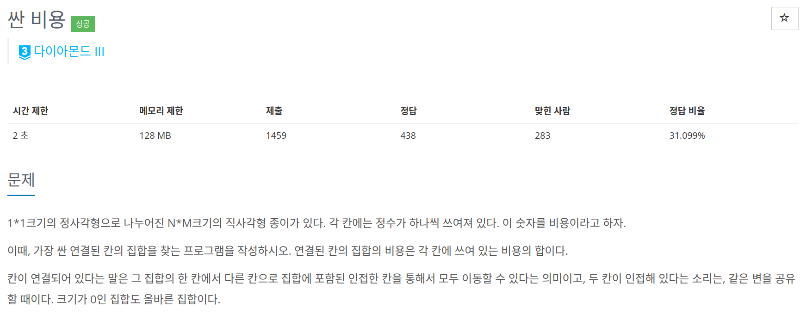

[상위 페이지 · 알고리즘](/study/algorithms/)



## 문제 태그

- DP
- 커넥션 프로파일을 이용한 DP

## 아이디어

- 칸을 위에서 아래로, 각 행에서는 왼쪽에서 오른쪽으로 본다. 아직 처리하지 않은 칸과 인접한 경계 M칸에서 어떤 선택 칸들이 연결돼 있는지만 기록한다.
- 상태 문자열의 0은 선택하지 않은 칸이다. 같은 번호를 가진 칸은 이미 처리한 영역에서 서로 연결돼 있다. 같은 연결 관계를 여러 문자열로 저장하지 않도록 왼쪽부터 등장하는 순서대로 번호를 다시 붙인다.
- 현재 칸을 고르면 위와 왼쪽에 있는 연결 요소에 붙이고, 두 요소가 다르면 합친다. 첫 열에서는 이전 행의 마지막 칸을 왼쪽 이웃으로 보면 안 된다.
- 현재 칸을 건너뛸 때 경계에서 어떤 요소의 마지막 칸이 사라지면, 나중에 그 요소를 다른 선택 칸과 연결할 방법이 없다. 계속 탐색하는 분기에서는 이 경우를 막는다. 지금까지 선택한 칸이 이미 하나로 연결됐다면 그 상태에서 더 고르지 않고 끝낼 수 있다.

빈 집합도 가능하므로 모든 칸의 비용이 양수라면 답은 0이다. DFS 결과는 현재 칸과 정규화한 경계 상태를 키로 메모한다.

[백준 문제](https://www.acmicpc.net/problem/1144) · [Algorithm 저장소 코드](https://github.com/Creeper0809/Algorithm/blob/e607692decddf5cee6a9ade117d588eb6e7e376b/Solve/%EB%8F%99%EC%A0%81%EA%B3%84%ED%9A%8D%EB%B2%95/1144.py)

## 정답

```python
import sys

input = sys.stdin.readline

INF = 10**9 + 7

def norm(s):
    mapping = {}
    t = 1
    for c in s:
        if c != '0' and c not in mapping:
            mapping[c] = str(t)
            t += 1
    ret = ''.join(mapping.get(c, '0') if c != '0' else '0' for c in s)
    return ret

def merge(s):
    ret = s[1:]
    if s[0] == '0' and s[-1] == '0':
        ret += '9'
    elif s[0] == '0':
        ret += s[-1]
    elif s[-1] == '0' or s[0] == s[-1]:
        ret += s[0]
    else:
        ret += s[0]
        ret = ret.replace(s[-1], s[0])
    return norm(ret)

def merge2(s):
    ret = s[1:]
    if s[0] == '0':
        ret += '9'
    else:
        ret += s[0]
    return norm(ret)

def check_pass(s):
    if s[0] == '0':
        return True
    return s[0] in s[1:]

def check_valid(s):
    unique_digits = {c for c in s if c != '0'}
    return len(unique_digits) <= 1

def dfs(x, y, cur, v, cache, n, m):
    if x == n:
        return 0 if check_valid(cur) else INF
    cur = norm(cur)
    if cur in cache[x][y]:
        return cache[x][y][cur]
    ret = INF
    nx = x
    ny = y + 1
    if ny >= m:
        nx += 1
        ny = 0
    if check_pass(cur):
        nxt = cur[1:] + '0'
        ret = min(ret, dfs(nx, ny, nxt, v, cache, n, m))
    next_cur = merge(cur) if y else merge2(cur)
    cost = dfs(nx, ny, next_cur, v, cache, n, m) + v[x][y]
    ret = min(ret, cost)
    if check_valid(cur):
        ret = min(ret, 0)
    cache[x][y][cur] = ret
    return ret

n, m = map(int, input().split())
v = [list(map(int, input().split())) for _ in range(n)]

cache = [[{} for _ in range(m)] for _ in range(n)]
print(dfs(0, 0, '0' * m, v, cache, n, m))
```
