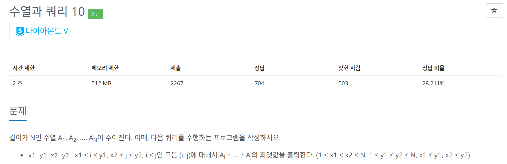

[상위 페이지 · 알고리즘](/study/algorithms/)



## 문제 태그

- 자료 구조
- 세그먼트 트리
- 최대 부분 배열 문제

## 아이디어

- 세그먼트 트리에 구간 합, 최대 접두합, 최대 접미합, 최대 연속 부분합을 저장한다. 두 구간을 합칠 때 경계를 건너는 부분합은 왼쪽 접미합과 오른쪽 접두합을 더한 값이다.
- 두 후보 구간이 떨어져 있으면 첫 구간에서 시작해 끝까지 가고, 가운데를 통과한 다음, 두 번째 구간의 처음부터 끝점을 고른다. 왼쪽 최대 접미합 + 가운데 전체 합 + 오른쪽 최대 접두합으로 바로 구할 수 있다.
- 두 구간이 겹치면 x₂~y₁ 안에 양 끝이 모두 있는 최대 부분합, 겹치는 구간의 왼쪽에서 시작해서 안쪽에서 끝나는 경우, y₁보다 오른쪽에서 끝나는 경우를 따로 계산한다. 두 번째 경우는 끝점의 최대 누적합에서 시작점 바로 앞의 최소 누적합을 빼면 된다. 마지막 경우는 y₁을 경계로 접미합과 접두합을 붙인다.

예를 들어 두 구간이 [1, 2]와 [4, 5]라면 중간의 3번 원소는 항상 포함된다. 모든 값이 음수일 때도 빈 구간을 선택할 수 없으므로 리프의 네 값은 전부 원소 자신으로 초기화한다. 구간 조회는 쿼리당 O(log N)이다.

[백준 문제](https://www.acmicpc.net/problem/13557) · [Algorithm 저장소 코드](https://github.com/Creeper0809/Algorithm/blob/e607692decddf5cee6a9ade117d588eb6e7e376b/Solve/%EC%9E%90%EB%A3%8C%EA%B5%AC%EC%A1%B0/13557.py)

## 정답

```python
import sys

input = sys.stdin.readline

INF = float('inf')
NINF = float('-inf')

class Node:
    def __init__(self, prefix=0, suffix=0, sub=0, total=0):
        self.prefix = prefix
        self.suffix = suffix
        self.sub = sub
        self.total = total

class SegTree:
    def __init__(self, arr):
        self.n = len(arr) - 1
        self.tree = [Node() for _ in range(4 * (self.n + 1))]
        self.build(1, 1, self.n, arr)

    def build(self, node, start, end, arr):
        if start == end:
            val = arr[start]
            self.tree[node] = Node(val, val, val, val)
            return
        mid = (start + end) // 2
        self.build(2 * node, start, mid, arr)
        self.build(2 * node + 1, mid + 1, end, arr)
        self.tree[node] = self.merge(self.tree[2 * node], self.tree[2 * node + 1])

    def merge(self, left, right):
        prefix = max(left.prefix, left.total + right.prefix)
        suffix = max(right.suffix, right.total + left.suffix)
        sub = max(left.sub, right.sub, left.suffix + right.prefix)
        total = left.total + right.total
        return Node(prefix, suffix, sub, total)

    def query(self, node, start, end, l, r):
        if r < start or end < l:
            return None
        if l <= start and end <= r:
            return self.tree[node]
        mid = (start + end) // 2
        left_q = self.query(2 * node, start, mid, l, r)
        right_q = self.query(2 * node + 1, mid + 1, end, l, r)
        if left_q is None:
            return right_q
        if right_q is None:
            return left_q
        return self.merge(left_q, right_q)

class MinSeg:
    def __init__(self, arr):
        self.n = len(arr) - 1
        self.tree = [INF] * (4 * (self.n + 1))
        self.build(1, 0, self.n, arr)

    def build(self, node, start, end, arr):
        if start == end:
            self.tree[node] = arr[start]
            return
        mid = (start + end) // 2
        self.build(2 * node, start, mid, arr)
        self.build(2 * node + 1, mid + 1, end, arr)
        self.tree[node] = min(self.tree[2 * node], self.tree[2 * node + 1])

    def query(self, node, start, end, l, r):
        if r < start or end < l:
            return INF
        if l <= start and end <= r:
            return self.tree[node]
        mid = (start + end) // 2
        return min(self.query(2 * node, start, mid, l, r), self.query(2 * node + 1, mid + 1, end, l, r))

class MaxSeg:
    def __init__(self, arr):
        self.n = len(arr) - 1
        self.tree = [NINF] * (4 * (self.n + 1))
        self.build(1, 0, self.n, arr)

    def build(self, node, start, end, arr):
        if start == end:
            self.tree[node] = arr[start]
            return
        mid = (start + end) // 2
        self.build(2 * node, start, mid, arr)
        self.build(2 * node + 1, mid + 1, end, arr)
        self.tree[node] = max(self.tree[2 * node], self.tree[2 * node + 1])

    def query(self, node, start, end, l, r):
        if r < start or end < l:
            return NINF
        if l <= start and end <= r:
            return self.tree[node]
        mid = (start + end) // 2
        return max(self.query(2 * node, start, mid, l, r), self.query(2 * node + 1, mid + 1, end, l, r))

N = int(input())
A = [0] + list(map(int, input().split()))
P = [0] * (N + 1)
for i in range(1, N + 1):
    P[i] = P[i - 1] + A[i]

seg = SegTree(A)
minp = MinSeg(P)
maxp = MaxSeg(P)

M = int(input())
for _ in range(M):
    x1, y1, x2, y2 = map(int, input().split())
    if y1 < x2:
        max_suf = seg.query(1, 1, N, x1, y1).suffix if x1 <= y1 else NINF
        tot_mid = P[x2 - 1] - P[y1]
        max_pre = seg.query(1, 1, N, x2, y2).prefix if x2 <= y2 else NINF
        ans = max_suf + tot_mid + max_pre
    else:
        ans = seg.query(1, 1, N, x2, y1).sub if x2 <= y1 else NINF
        if x1 < x2:
            min_left = minp.query(1, 0, N, x1 - 1, x2 - 2)
            max_right = maxp.query(1, 0, N, x2, y1)
            ans = max(ans, max_right - min_left)
        if y1 < y2:
            max_suf_left = seg.query(1, 1, N, x1, y1).suffix if x1 <= y1 else NINF
            max_pre_right = seg.query(1, 1, N, y1 + 1, y2).prefix if y1 + 1 <= y2 else NINF
            ans = max(ans, max_suf_left + max_pre_right)
    print(ans)
```
