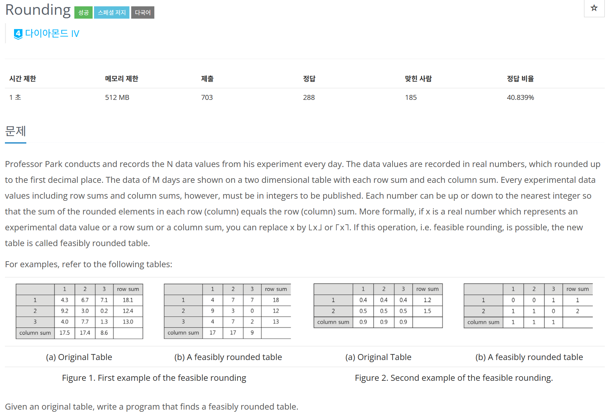

[상위 페이지 · 알고리즘](/study/algorithms/)



## 문제 태그

- 그래프 이론
- 최대 유량
- 서큘레이션

## 아이디어

- 각 칸은 소수 첫째 자리를 버린 값과 올림한 값 사이에서 고른다. 행 합과 열 합도 주어진 값의 내림 또는 올림이어야 하므로, 세 종류를 전부 하한과 상한이 있는 간선으로 바꾼다. 이미 정수인 값은 하한과 상한이 같다.
- 행에서 열로 가는 유량을 해당 칸의 값으로 둔다. 행으로 들어오는 양이 행의 합이 되고, 열에서 나가는 양이 열의 합이 된다. 전체를 다시 순환시키는 간선까지 넣으면 행 합의 총합과 열 합의 총합이 일치한다.
- 일반 최대 유량은 하한을 직접 처리하지 못한다. 먼저 각 간선에 하한만큼 보낸 뒤 남은 용량을 상한 − 하한으로 두고, 정점마다 생긴 유량의 과부족을 보조 소스와 싱크로 연결한다. 이 과부족을 전부 메울 수 있으면 유량 보존 조건을 만족하는 표가 나온다.

예를 들어 4.3인 칸은 우선 4로 채우고, 해당 간선을 통해 잔여 유량이 1 더 흐른 경우에만 5가 된다. 출력할 때는 처음 넣은 하한과 나중에 흘린 양을 합쳐야 한다.

[백준 문제](https://www.acmicpc.net/problem/13569) · [Algorithm 저장소 코드](https://github.com/Creeper0809/Algorithm/blob/e607692decddf5cee6a9ade117d588eb6e7e376b/Solve/%EA%B7%B8%EB%9E%98%ED%94%84/13569.py)

## 정답

```cpp
#include <bits/stdc++.h>
using namespace std;
typedef long long ll;

struct Edge {
    int to;
    ll cap;
    int rev;
};

vector<vector<Edge>> G;
vector<int> level, iter;

void add_edge(int from, int to, ll cap) {
    if (cap <= 0) return;
    G[from].push_back({to, cap, (int)G[to].size()});
    G[to].push_back({from, 0, (int)G[from].size() - 1});
}

void bfs(int s) {
    fill(level.begin(), level.end(), -1);
    level[s] = 0;
    queue<int> q;
    q.push(s);
    while (!q.empty()) {
        int u = q.front(); q.pop();
        for (auto &e : G[u]) {
            if (e.cap > 0 && level[e.to] < 0) {
                level[e.to] = level[u] + 1;
                q.push(e.to);
            }
        }
    }
}

ll dfs(int u, int t, ll f) {
    if (u == t) return f;
    for (int &i = iter[u]; i < (int)G[u].size(); i++) {
        Edge &e = G[u][i];
        if (e.cap > 0 && level[u] < level[e.to]) {
            ll d = dfs(e.to, t, min(f, e.cap));
            if (d > 0) {
                e.cap -= d;
                G[e.to][e.rev].cap += d;
                return d;
            }
        }
    }
    return 0;
}

ll max_flow(int s, int t) {
    ll flow = 0;
    while (true) {
        bfs(s);
        if (level[t] < 0) return flow;
        fill(iter.begin(), iter.end(), 0);
        ll f;
        while ((f = dfs(s, t, LLONG_MAX / 2)) > 0) {  // 안전한 INF 값
            flow += f;
        }
    }
}

int main() {
    ios::sync_with_stdio(false);
    cin.tie(NULL);
    int M, N;
    cin >> M >> N;
    vector<vector<int>> A_floor(M, vector<int>(N, 0));
    vector<vector<int>> A_dec(M, vector<int>(N, 0));
    vector<int> r_floor(M, 0), r_dec(M, 0);
    for (int i = 0; i < M; i++) {
        for (int k = 0; k < N + 1; k++) {
            string val;
            cin >> val;
            size_t dot = val.find('.');
            int fl = 0, de = 0;
            if (dot != string::npos) {
                fl = stoi(val.substr(0, dot));
                de = stoi(val.substr(dot + 1));
            } else {
                fl = stoi(val);
                de = 0;
            }
            if (k < N) {
                A_floor[i][k] = fl;
                A_dec[i][k] = de;
            } else {
                r_floor[i] = fl;
                r_dec[i] = de;
            }
        }
    }
    vector<int> c_floor(N, 0), c_dec(N, 0);
    for (int j = 0; j < N; j++) {
        string val;
        cin >> val;
        size_t dot = val.find('.');
        int fl = 0, de = 0;
        if (dot != string::npos) {
            fl = stoi(val.substr(0, dot));
            de = stoi(val.substr(dot + 1));
        } else {
            fl = stoi(val);
            de = 0;
        }
        c_floor[j] = fl;
        c_dec[j] = de;
    }
    int r0 = 0;
    int r_start = 1;
    int c0 = M + 1;
    int c_start = M + 2;
    int num_nodes = M + 1 + N + 1;
    int s = num_nodes;
    int t = num_nodes + 1;
    G.resize(num_nodes + 2);
    level.resize(num_nodes + 2);
    iter.resize(num_nodes + 2);
    vector<tuple<int, int, int, int>> arc_list;
    for (int i = 0; i < M; i++) {
        int ri = r_start + i;
        for (int j = N - 1; j >= 0; j--) {
            int cj = c_start + j;
            int l = A_floor[i][j];
            int uu = l + (A_dec[i][j] > 0 ? 1 : 0);
            arc_list.emplace_back(ri, cj, l, uu);
        }
    }
    for (int i = M - 1; i >= 0; i--) {
        int ri = r_start + i;
        int l = r_floor[i];
        int uu = l + (r_dec[i] > 0 ? 1 : 0);
        arc_list.emplace_back(c0, ri, l, uu);
    }
    for (int j = 0; j < N; j++) {
        int cj = c_start + j;
        int l = c_floor[j];
        int uu = l + (c_dec[j] > 0 ? 1 : 0);
        arc_list.emplace_back(cj, r0, l, uu);
    }
    int sum_r_l = 0;
    for (int x : r_floor) sum_r_l += x;
    int sum_r_u = sum_r_l;
    for (int d : r_dec) if (d > 0) sum_r_u++;
    int sum_c_l = 0;
    for (int x : c_floor) sum_c_l += x;
    int sum_c_u = sum_c_l;
    for (int d : c_dec) if (d > 0) sum_c_u++;
    int total_l = max(sum_r_l, sum_c_l);
    int total_u = min(sum_r_u, sum_c_u);
    arc_list.emplace_back(r0, c0, total_l, total_u);
    vector<ll> delta(num_nodes, 0);
    for (auto &[u, v, l, uu] : arc_list) {
        delta[u] += l;
        delta[v] -= l;
    }
    for (auto &[u, v, l, uu] : arc_list) {
        ll cap = uu - l;
        if (cap > 0) {
            add_edge(u, v, cap);
        }
    }
    ll required_flow = 0;
    for (int node = 0; node < num_nodes; node++) {
        if (delta[node] > 0) {
            add_edge(node, t, delta[node]);
            required_flow += delta[node];
        } else if (delta[node] < 0) {
            add_edge(s, node, -delta[node]);
        }
    }
    max_flow(s, t);
    vector<vector<int>> rounded_a(M, vector<int>(N, 0));
    for (int i = 0; i < M; i++) {
        int ri = r_start + i;
        for (int j = 0; j < N; j++) {
            int cj = c_start + j;
            int additional = 0;
            if (A_dec[i][j] > 0) {
                for (auto &e : G[cj]) {
                    if (e.to == ri) {
                        additional = e.cap;
                        break;
                    }
                }
            }
            rounded_a[i][j] = A_floor[i][j] + additional;
        }
    }
    vector<int> rounded_row(M, 0);
    for (int i = 0; i < M; i++) {
        int ri = r_start + i;
        int additional = 0;
        if (r_dec[i] > 0) {
            for (auto &e : G[ri]) {
                if (e.to == c0) {
                    additional = e.cap;
                    break;
                }
            }
        }
        rounded_row[i] = r_floor[i] + additional;
    }
    vector<int> rounded_col(N, 0);
    for (int j = 0; j < N; j++) {
        int cj = c_start + j;
        int additional = 0;
        if (c_dec[j] > 0) {
            for (auto &e : G[r0]) {
                if (e.to == cj) {
                    additional = e.cap;
                    break;
                }
            }
        }
        rounded_col[j] = c_floor[j] + additional;
    }
    for (int i = 0; i < M; i++) {
        for (int j = 0; j < N; j++) {
            cout << rounded_a[i][j] << ' ';
        }
        cout << rounded_row[i] << '\n';
    }
    for (int j = 0; j < N; j++) {
        cout << rounded_col[j];
        if (j < N - 1) cout << ' ';
    }
    cout << '\n';
    return 0;
}
```
