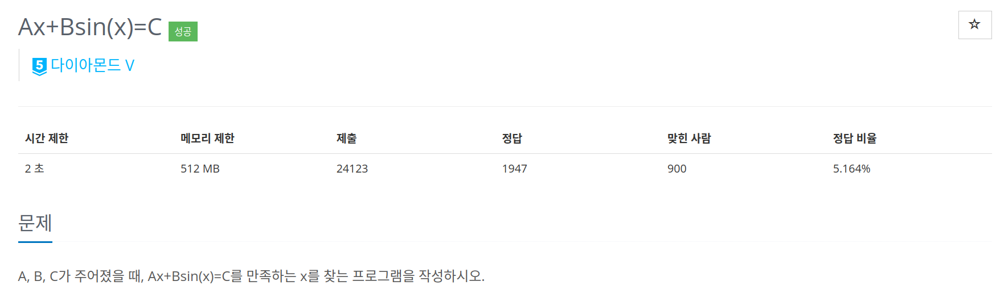

[상위 페이지 · 알고리즘](/study/algorithms/)



## 문제 태그

- 수학
- 이분 탐색
- 임의 정밀도 / 큰 수 연산
- 수치해석

## 아이디어

- f(x) = Ax + B sin(x)라고 두면 f′(x) = A + B cos(x)다. 입력에서 A ≥ B이므로 미분값은 음수가 되지 않는다. A = B일 때 일부 점에서 미분값이 0이 되지만 구간 전체가 평평해지지는 않는다. f(x)가 C보다 작은지 보고 이분 탐색으로 범위를 줄일 수 있다.
- f(0)은 0이고, 충분히 큰 x에서 Ax − B가 C를 넘는다. 코드에서는 0부터 5,000,000까지를 탐색한다.
- sin은 x를 먼저 2π로 나눈 나머지로 줄이고 테일러 급수로 계산한다. 각 항의 분자와 분모는 이전 항에서 곱셈으로 갱신하고, Decimal 정밀도에서 새 항을 더해도 합이 같아지면 멈춘다.

근을 충분히 좁힌 다음 마지막에만 소수점 아래 여섯 자리로 반올림한다. 탐색 중간에 x나 sin(x)를 먼저 반올림하면 어느 반쪽을 남겨야 하는지 경계에서 잘못 판단할 수 있다.

[백준 문제](https://www.acmicpc.net/problem/13705) · [Algorithm 저장소 코드](https://github.com/Creeper0809/Algorithm/blob/e607692decddf5cee6a9ade117d588eb6e7e376b/Solve/%EC%88%98%ED%95%99/13705.py)

## 정답

```python
from decimal import *

getcontext().prec = 150
D = Decimal
decpi = Decimal("3.1415926535897932384626433832795028841971693993751058209749445923078164062862089986280348253421170679821480865132823066470938446095505822317253594081284811174502841027019385211055596446229489549303819644288109756659334461284756482337867831652712019091456485669234603486104543266482133936072602491412737245870066063155881748815209209628292540917153643678925903600113305305488204665213841469519415116094330572703657595919530921861173819326117931051185480744623799627495673518857527248912279381830119491298336733624406566430860213949463952247371907021798609437027705392171762")
getcontext().rounding = ROUND_HALF_UP

def sin(x):
    x = x % (2 * decpi)
    i, lasts, s, fact, num, sign = D(1), D(0), D(x), D(1), D(x), D(1)
    while s != lasts:
        lasts = s
        i += 2
        fact *= i * (i - 1)
        num *= x * x
        sign *= -1
        s += num / fact * sign
    return D(s)

a, b, c = map(Decimal, input().split())
x = Decimal()
lo = Decimal(0)
hi = Decimal(5000000)
tol = Decimal("1.0e-60")

while (hi - lo).copy_abs() >= tol:
    x = (lo + hi) / 2
    if (a * x + b * sin(x)) < c:
        lo = x
    else:
        hi = x

final_result = x.quantize(Decimal('0.000001'))
print(final_result)
```
