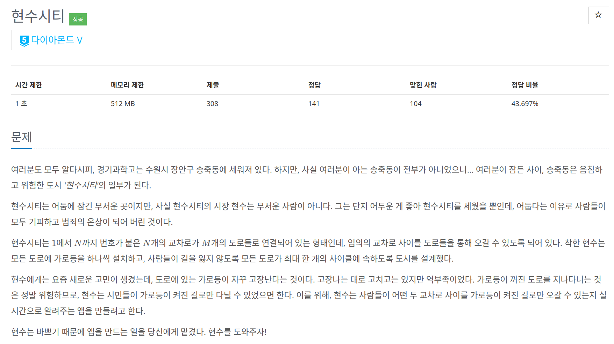

[상위 페이지 · 알고리즘](/study/algorithms/)



## 문제 태그

- 자료 구조
- 그래프 이론
- 분리 집합
- 분할 정복
- 오프라인 쿼리
- 오프라인 동적 연결성 판정

## 아이디어

- 가로등이 켜진 도로만 남겼을 때 두 교차로가 같은 연결 요소에 있는지 묻는 문제다. 도로마다 처음 상태와 반전된 시각을 모아, 켜져 있는 시간 구간으로 바꾼다.
- 쿼리의 시간 범위를 반씩 나눈다. 지금 보는 범위 전체에서 켜져 있는 도로는 유니온 파인드에 합치고, 일부에서만 켜져 있으면 겹치는 자식 범위로 넘긴다. 범위가 시각 하나가 되면 그때의 연결 여부를 구한다.
- 왼쪽 시간대를 보고 오른쪽으로 넘어갈 때 왼쪽에서 한 합치기는 되돌려야 한다. 합쳐진 루트의 부모와 랭크 등을 스택에 기록하고 역순으로 복구한다. 경로 압축은 부모를 한꺼번에 많이 바꾸므로 여기서는 랭크만 사용한다.

예를 들어 처음 켜진 도로를 세 번째 연산에서 끄면 그 전의 조회에만 이 도로가 들어간다. 반전과 조회는 같은 시각에 나오지 않으므로 저장소 코드는 반전 위치까지 이전 구간에 두고 다음 위치에서 상태를 바꾼다.

[백준 문제](https://www.acmicpc.net/problem/15316) · [Algorithm 저장소 코드](https://github.com/Creeper0809/Algorithm/blob/e607692decddf5cee6a9ade117d588eb6e7e376b/Solve/%EA%B7%B8%EB%9E%98%ED%94%84/15316.py)

## 정답

```python
import sys

input = sys.stdin.readline

class UnionFind:
    def __init__(self, n):
        self.parent = [i for i in range(n)]
        self.rank = [0] * n
        self.set_size = [1] * n

    def find(self, x):
        while self.parent[x] != x:
            x = self.parent[x]
        return x

    def union(self, x, y):
        x_root = self.find(x)
        y_root = self.find(y)
        if x_root == y_root:
            return False, None
        if self.rank[x_root] < self.rank[y_root]:
            x_root, y_root = y_root, x_root
        old_parent = self.parent[y_root]
        old_rank = self.rank[x_root]
        old_size = self.set_size[x_root]
        self.parent[y_root] = x_root
        if self.rank[x_root] == self.rank[y_root]:
            self.rank[x_root] += 1
        self.set_size[x_root] += self.set_size[y_root]
        return True, (x_root, y_root, old_parent, old_rank, old_size)

    def same(self, x, y):
        return self.find(x) == self.find(y)

class EdgeInterval:
    def __init__(self, u, v, start, end):
        self.u = u
        self.v = v
        self.start = start
        self.end = end

N, M = map(int, input().split())
edges = [None] * (M + 1)
for i in range(1, M + 1):
    edges[i] = tuple(map(int, input().split()))
initial_status = [0] * (M + 1)
initial_status[1:] = map(int, input().split())
Q = int(input().strip())
ops = [None] * (Q + 1)
for i in range(1, Q + 1):
    ops[i] = list(map(int, input().split()))

query_info = [None] * (Q + 1)
query_count = 0
for i in range(1, Q + 1):
    if ops[i][0] == 2:
        a, b = ops[i][1], ops[i][2]
        query_info[i] = (a, b, query_count)
        query_count += 1

answers = [''] * query_count

toggle_per_edge = [[] for _ in range(M + 1)]
for i in range(1, Q + 1):
    if ops[i][0] == 1:
        eid = ops[i][1]
        toggle_per_edge[eid].append(i)

intervals = []
for eid in range(1, M + 1):
    u, v = edges[eid]
    init = initial_status[eid]
    toggles = toggle_per_edge[eid]
    if not toggles:
        if init == 1:
            intervals.append(EdgeInterval(u, v, 1, Q))
        continue
    parity = 0
    end = toggles[0]
    if (init ^ parity) == 1 and 1 <= end:
        intervals.append(EdgeInterval(u, v, 1, end))
    parity = 1 - parity
    for j in range(1, len(toggles)):
        start = toggles[j - 1] + 1
        end = toggles[j]
        if start <= end and (init ^ parity) == 1:
            intervals.append(EdgeInterval(u, v, start, end))
        parity = 1 - parity
    start = toggles[-1] + 1
    end = Q
    if start <= end and (init ^ parity) == 1:
        intervals.append(EdgeInterval(u, v, start, end))

uf = UnionFind(N + 1)

def solve(L, R, active_ints):
    if L > R:
        return
    mid = (L + R) // 2
    cover = []
    left_ints = []
    right_ints = []
    for intv in active_ints:
        if intv.start <= L and R <= intv.end:
            cover.append(intv)
        else:
            if intv.end >= L and intv.start <= mid:
                left_ints.append(intv)
            if intv.end >= mid + 1 and intv.start <= R:
                right_ints.append(intv)
    changes = []
    for intv in cover:
        merged, change = uf.union(intv.u, intv.v)
        if merged:
            changes.append(change)
    if L == R:
        if query_info[L]:
            a, b, idx = query_info[L]
            answers[idx] = 'YES' if uf.same(a, b) else 'NO'
    else:
        solve(L, mid, left_ints)
        solve(mid + 1, R, right_ints)
    for change in reversed(changes):
        x_root, y_root, old_parent, old_rank, old_size = change
        uf.parent[y_root] = old_parent
        uf.rank[x_root] = old_rank
        uf.set_size[x_root] = old_size

solve(1, Q, intervals)
print('\n'.join(answers))
```
