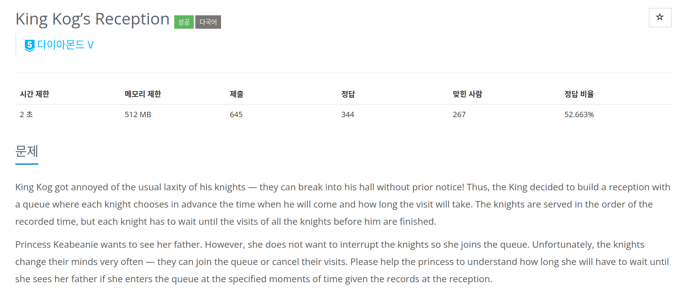

[상위 페이지 · 알고리즘](/study/algorithms/)



## 문제 태그

- 자료 구조
- 세그먼트 트리
- 느리게 갱신되는 세그먼트 트리

## 아이디어

- 상담 시간이 앞에서 밀리면 다음 사람의 시작 시각은 도착 시각과 직전 상담 종료 시각 중 큰 값이다. 등록과 취소가 있으므로 매번 처음부터 이 과정을 돌기는 어렵다.
- 도착 시각을 좌표 압축하고 각 구간에 상담 시간 합과, 대기 중인 사람 없이 들어왔을 때 구간을 마치는 시각을 저장한다. 두 구간을 합치면 이전 구간 종료 시각에 오른쪽 상담 시간 합을 더한 값과, 오른쪽 구간만 따로 계산한 종료 시각 중 큰 값이 된다.
- 등록과 취소는 각각 해당 시각에 상담 시간을 더하고 빼는 점 갱신이다. 질의에서는 도착 시각 t 이하의 구간만 왼쪽부터 합치고, 마지막 종료 시각에서 t를 빼되 음수라면 0을 출력한다.

예를 들어 2시에 5만큼 걸리는 상담이 먼저 있고 4시에 3만큼 걸리는 상담이 있으면 두 번째 상담은 7에 시작해 10에 끝난다. 4에 도착한 사람은 같은 시각에 도착한 예약도 앞에 포함되므로 6만큼 기다린다. 갱신과 조회는 각각 O(log Q)다.

[백준 문제](https://www.acmicpc.net/problem/16670) · [Algorithm 저장소 코드](https://github.com/Creeper0809/Algorithm/blob/e607692decddf5cee6a9ade117d588eb6e7e376b/Solve/%EC%9E%90%EB%A3%8C%EA%B5%AC%EC%A1%B0/16670.py)

## 정답

```python
import sys
import bisect

input = sys.stdin.readline

class SegmentTree:
    def __init__(self, n, T):
        self.n = n
        self.T = T
        self.tree_sum = [0] * (4 * (n + 1))
        self.tree_max = [0] * (4 * (n + 1))
        self.build(1, 1, n)

    def build(self, node, l, r):
        if l == r:
            self.tree_sum[node] = 0
            self.tree_max[node] = self.T[l - 1]
            return
        mid = (l + r) // 2
        self.build(2 * node, l, mid)
        self.build(2 * node + 1, mid + 1, r)
        self.tree_sum[node] = self.tree_sum[2 * node] + self.tree_sum[2 * node + 1]
        self.tree_max[node] = max(self.tree_max[2 * node + 1], self.tree_max[2 * node] + self.tree_sum[2 * node + 1])

    def update(self, idx, val):
        self._update(1, 1, self.n, idx, val)

    def _update(self, node, l, r, idx, val):
        if l == r:
            self.tree_sum[node] += val
            self.tree_max[node] += val
            return
        mid = (l + r) // 2
        if idx <= mid:
            self._update(2 * node, l, mid, idx, val)
        else:
            self._update(2 * node + 1, mid + 1, r, idx, val)
        self.tree_sum[node] = self.tree_sum[2 * node] + self.tree_sum[2 * node + 1]
        self.tree_max[node] = max(self.tree_max[2 * node + 1], self.tree_max[2 * node] + self.tree_sum[2 * node + 1])

    def query(self, x):
        if x < 1:
            return 0
        return self._query(1, 1, self.n, x, 0)

    def _query(self, node, l, r, x, ans):
        if r <= x:
            ans = max(self.tree_max[node], ans + self.tree_sum[node])
            return ans
        mid = (l + r) // 2
        ans = self._query(2 * node, l, mid, x, ans)
        if mid < x:
            ans = self._query(2 * node + 1, mid + 1, r, x, ans)
        return ans

q = int(input())
events = []
t_set = set()
for _ in range(q):
    line = input().strip().split()
    events.append(line)
    if line[0] in ['+', '?']:
        t_set.add(int(line[1]))

T = sorted(list(t_set))
m = len(T)
rank = {T[i]: i + 1 for i in range(m)}

st = SegmentTree(m, T)
event_info = [None] * (q + 1)

for event_num in range(1, q + 1):
    line = events[event_num - 1]
    typ = line[0]
    if typ == '+':
        t = int(line[1])
        d = int(line[2])
        event_info[event_num] = (t, d)
        r = rank[t]
        st.update(r, d)
    elif typ == '-':
        i = int(line[1])
        t, d = event_info[i]
        r = rank[t]
        st.update(r, -d)
    elif typ == '?':
        qp = int(line[1])
        idx = bisect.bisect_right(T, qp)
        ans = st.query(idx)
        print(max(ans - qp, 0))
```
