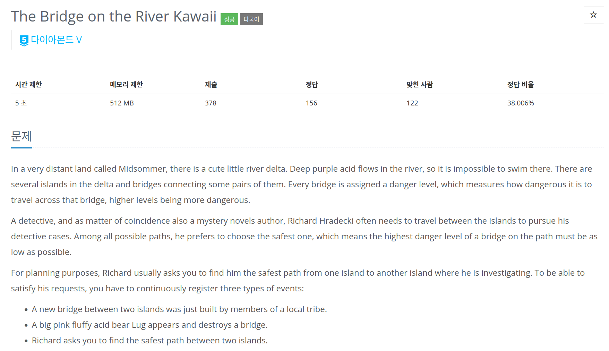

[상위 페이지 · 알고리즘](/study/algorithms/)



## 문제 태그

- 자료 구조
- 그래프 이론
- 분리 집합
- 분할 정복
- 오프라인 쿼리
- 오프라인 동적 연결성 판정

## 아이디어

- 경로의 위험도는 그 위에서 가장 위험한 다리의 값이다. 위험도 d 이하인 다리만 놓고 두 섬이 연결된다면 답은 d 이하다. 다리의 위험도가 0~9라서 d를 작은 값부터 모두 확인해도 된다.
- 다리마다 건설부터 철거 직전까지의 시간 구간을 만든다. 각 d에서는 허용된 다리만 남기고 시간 분할 정복을 한다. 현재 시간 범위를 전부 덮는 다리는 합치고, 부분만 겹치면 자식 범위에 넘긴다. 질의 시각 하나에 도달하면 연결 여부를 보고, 재귀를 빠져나올 때 합친 내용을 롤백한다.
- 처음 연결된 d가 정답이다. d = 9에서도 연결되지 않으면 −1이 남는다.

예를 들어 직접 건너는 다리의 위험도가 5이고, 중간 섬을 거치는 두 다리가 2와 4라면 d = 4에서 처음 연결된다. 여러 다리의 위험도를 더할 필요 없이 가장 큰 값만 비교하면 된다.

[백준 문제](https://www.acmicpc.net/problem/16695) · [Algorithm 저장소 코드](https://github.com/Creeper0809/Algorithm/blob/e607692decddf5cee6a9ade117d588eb6e7e376b/Solve/%EA%B7%B8%EB%9E%98%ED%94%84/16695.py)

## 정답

```python
import sys
from collections import defaultdict

input = sys.stdin.readline

class UnionFind:
    def __init__(self, n):
        self.parent = [i for i in range(n)]
        self.rank = [1] * n
        self.set_size = [1] * n

    def find(self, x):
        while self.parent[x] != x:
            x = self.parent[x]
        return x

    def union(self, x, y):
        x_root = self.find(x)
        y_root = self.find(y)
        if x_root == y_root:
            return False, None
        if self.rank[x_root] < self.rank[y_root]:
            x_root, y_root = y_root, x_root
        old_parent = self.parent[y_root]
        old_rank = self.rank[x_root]
        old_size = self.set_size[x_root]
        self.parent[y_root] = x_root
        if self.rank[x_root] == self.rank[y_root]:
            self.rank[x_root] += 1
        self.set_size[x_root] += self.set_size[y_root]
        return True, (x_root, y_root, old_parent, old_rank, old_size)

    def same(self, x, y):
        return self.find(x) == self.find(y)

class EdgeInterval:
    def __init__(self, u, v, start, end, danger):
        self.u = u
        self.v = v
        self.start = start
        self.end = end
        self.danger = danger

N, Q = map(int, input().split())
queries = [None] * (Q + 1)
for i in range(1, Q + 1):
    queries[i] = list(map(int, input().split()))

query_info = [None] * (Q + 1)
type2_count = 0
for i in range(1, Q + 1):
    t = queries[i][0]
    if t == 2:
        query_info[i] = (queries[i][1], queries[i][2], type2_count)
        type2_count += 1

answers = [-1] * type2_count

active_bridges = {}
intervals = []
for i in range(1, Q + 1):
    t = queries[i][0]
    if t == 2:
        continue
    a, b = queries[i][1], queries[i][2]
    if a > b:
        a, b = b, a
    edge = (a, b)
    if t == 0:
        v = queries[i][3]
        active_bridges[edge] = (i, v)
    elif t == 1:
        if edge in active_bridges:
            add_t, v = active_bridges.pop(edge)
            intervals.append(EdgeInterval(a, b, add_t, i - 1, v))

for edge, (add_t, v) in active_bridges.items():
    a, b = edge
    intervals.append(EdgeInterval(a, b, add_t, Q, v))

def solve(L, R, active_ints, uf, d):
    if L > R:
        return
    mid = (L + R) // 2
    cover = []
    left_ints = []
    right_ints = []
    for intv in active_ints:
        if intv.start <= L and intv.end >= R:
            cover.append(intv)
        else:
            if intv.start <= mid and intv.end >= L:
                left_ints.append(intv)
            if intv.start <= R and intv.end >= mid + 1:
                right_ints.append(intv)
    changes = []
    for intv in cover:
        merged, change = uf.union(intv.u, intv.v)
        if merged:
            changes.append(change)
    if L == R:
        if query_info[L]:
            a, b, idx = query_info[L]
            if uf.same(a, b) and answers[idx] == -1:
                answers[idx] = d
    else:
        solve(L, mid, left_ints, uf, d)
        solve(mid + 1, R, right_ints, uf, d)
    for change in reversed(changes):
        x_root, y_root, old_parent, old_rank, old_size = change
        uf.parent[y_root] = old_parent
        uf.rank[x_root] = old_rank
        uf.set_size[x_root] = old_size

for d in range(10):
    active_ints = [intv for intv in intervals if intv.danger <= d]
    uf = UnionFind(N)
    solve(1, Q, active_ints, uf, d)

print('\n'.join(map(str, answers)))
```
