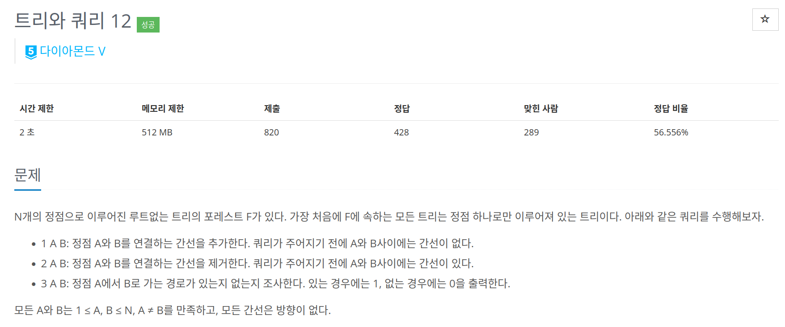

[상위 페이지 · 알고리즘](/study/algorithms/)



## 문제 태그

- 자료 구조
- 그래프 이론
- 분리 집합
- 분할 정복
- 오프라인 쿼리
- 오프라인 동적 연결성 판정

## 아이디어

- 간선 추가 시각과 삭제 시각을 짝지어 간선이 살아 있는 구간을 만든다. 추가 시각은 포함하고 삭제 시각은 제외한다. 삭제되지 않은 간선은 마지막 쿼리까지 남긴다.
- 시간 전체를 반으로 나누면서 현재 범위를 완전히 덮는 간선을 유니온 파인드에 합친다. 현재 범위의 일부에만 있는 간선은 왼쪽과 오른쪽 중 겹치는 곳으로 넘긴다. 시각 하나에 도달하면 그 시각에 살아 있는 간선만 반영된 상태에서 답을 구할 수 있다.
- 한 구간을 벗어날 때 그 구간에서 성공한 합치기만 역순으로 되돌린다. 랭크로 트리의 깊이를 줄이고, 부모 변경을 되돌리기 쉽도록 경로 압축은 쓰지 않는다.

예를 들어 시각 1에 추가한 간선이 시각 4에 삭제되면 1~3에서만 합친다. 16911은 일반 그래프가 되고 16912는 쿼리마다 포레스트가 유지된다. 이 풀이에서는 두 문제 모두 연결 여부만 물으므로 두 문제에 같은 코드를 쓸 수 있다.

[16911. 그래프와 쿼리](https://www.acmicpc.net/problem/16911) · [16912. 트리와 쿼리 12](https://www.acmicpc.net/problem/16912) · [Algorithm 저장소 코드](https://github.com/Creeper0809/Algorithm/blob/e607692decddf5cee6a9ade117d588eb6e7e376b/Solve/%EC%9E%90%EB%A3%8C%EA%B5%AC%EC%A1%B0/16911.py)

## 정답

```python
import sys
from collections import defaultdict

input = sys.stdin.readline

class UnionFind:
    def __init__(self, n):
        self.parent = [i for i in range(n)]
        self.rank = [1] * n
        self.set_size = [1] * n

    def find(self, x):
        while self.parent[x] != x:
            x = self.parent[x]
        return x

    def union(self, x, y):
        x_root = self.find(x)
        y_root = self.find(y)
        if x_root == y_root:
            return False, None
        if self.rank[x_root] < self.rank[y_root]:
            x_root, y_root = y_root, x_root
        old_parent = self.parent[y_root]
        old_rank = self.rank[x_root]
        old_size = self.set_size[x_root]
        self.parent[y_root] = x_root
        if self.rank[x_root] == self.rank[y_root]:
            self.rank[x_root] += 1
        self.set_size[x_root] += self.set_size[y_root]
        return True, (x_root, y_root, old_parent, old_rank, old_size)

    def same(self, x, y):
        return self.find(x) == self.find(y)

class EdgeInterval:
    def __init__(self, u, v, start, end):
        self.u = u
        self.v = v
        self.start = start
        self.end = end

N, M = map(int, input().split())
queries = [None] * (M + 1)
for i in range(1, M + 1):
    queries[i] = list(map(int, input().split()))

query_info = [None] * (M + 1)
type3_count = 0
for i in range(1, M + 1):
    t = queries[i][0]
    if t == 3:
        query_info[i] = (queries[i][1], queries[i][2], type3_count)
        type3_count += 1

answers = [0] * type3_count

last_adds = defaultdict(list)
intervals = []
for i in range(1, M + 1):
    t = queries[i][0]
    if t == 3:
        continue
    a, b = queries[i][1], queries[i][2]
    if a > b:
        a, b = b, a
    edge = (a, b)
    if t == 1:
        last_adds[edge].append(i)
    else:
        add_t = last_adds[edge].pop()
        intervals.append(EdgeInterval(a, b, add_t, i - 1))

for edge, adds in last_adds.items():
    a, b = edge
    for add_t in adds:
        intervals.append(EdgeInterval(a, b, add_t, M))

uf = UnionFind(N + 1)

def solve(L, R, active_ints):
    if L > R:
        return
    mid = (L + R) // 2
    cover = []
    left_ints = []
    right_ints = []
    for intv in active_ints:
        if intv.start <= L and R <= intv.end:
            cover.append(intv)
        else:
            if intv.end >= L and intv.start <= mid:
                left_ints.append(intv)
            if intv.end >= mid + 1 and intv.start <= R:
                right_ints.append(intv)
    changes = []
    for intv in cover:
        merged, change = uf.union(intv.u, intv.v)
        if merged:
            changes.append(change)
    if L == R:
        if query_info[L]:
            a, b, idx = query_info[L]
            answers[idx] = 1 if uf.same(a, b) else 0
    else:
        solve(L, mid, left_ints)
        solve(mid + 1, R, right_ints)
    for change in reversed(changes):
        x_root, y_root, old_parent, old_rank, old_size = change
        uf.parent[y_root] = old_parent
        uf.rank[x_root] = old_rank
        uf.set_size[x_root] = old_size

solve(1, M, intervals)
print('\n'.join(map(str, answers)))
```
