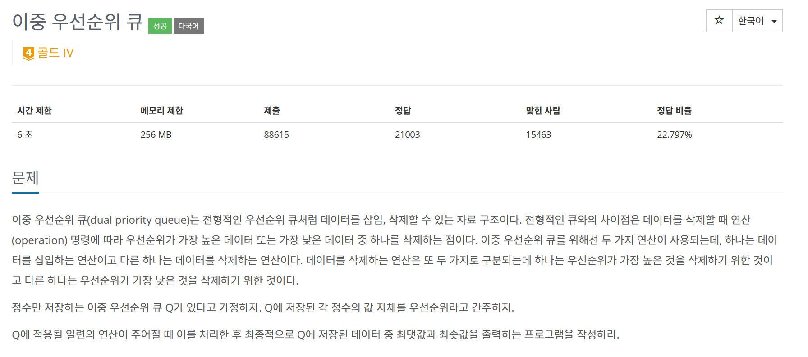

[상위 페이지 · 미정리](/study/algorithms/unsorted/)



## 문제 태그

- 자료구조
- 집합과 맵
- 트리를 사용한 집합과 맵
- 우선순위 큐

## 아이디어

## 정답

```python
import sys
import heapq

T = int(sys.stdin.readline())

for _ in range(T):
    k = int(sys.stdin.readline())
    min_heap = []
    max_heap = []
    is_valid = {}

    for _ in range(k):
        op, n_str = sys.stdin.readline().split()
        n = int(n_str)

        if op == 'I':
            heapq.heappush(min_heap, n)
            heapq.heappush(max_heap, -n)
            is_valid[n] = is_valid.get(n, 0) + 1
        else:
            if n == 1:
                while max_heap and is_valid.get(-max_heap[0], 0) == 0:
                    heapq.heappop(max_heap)
                if max_heap:
                    val = -heapq.heappop(max_heap)
                    is_valid[val] -= 1
            else:
                while min_heap and is_valid.get(min_heap[0], 0) == 0:
                    heapq.heappop(min_heap)
                if min_heap:
                    val = heapq.heappop(min_heap)
                    is_valid[val] -= 1

    while max_heap and is_valid.get(-max_heap[0], 0) == 0:
        heapq.heappop(max_heap)
    
    while min_heap and is_valid.get(min_heap[0], 0) == 0:
        heapq.heappop(min_heap)

    if not max_heap:
        print('EMPTY')
    else:
        print(-max_heap[0], min_heap[0])
```
